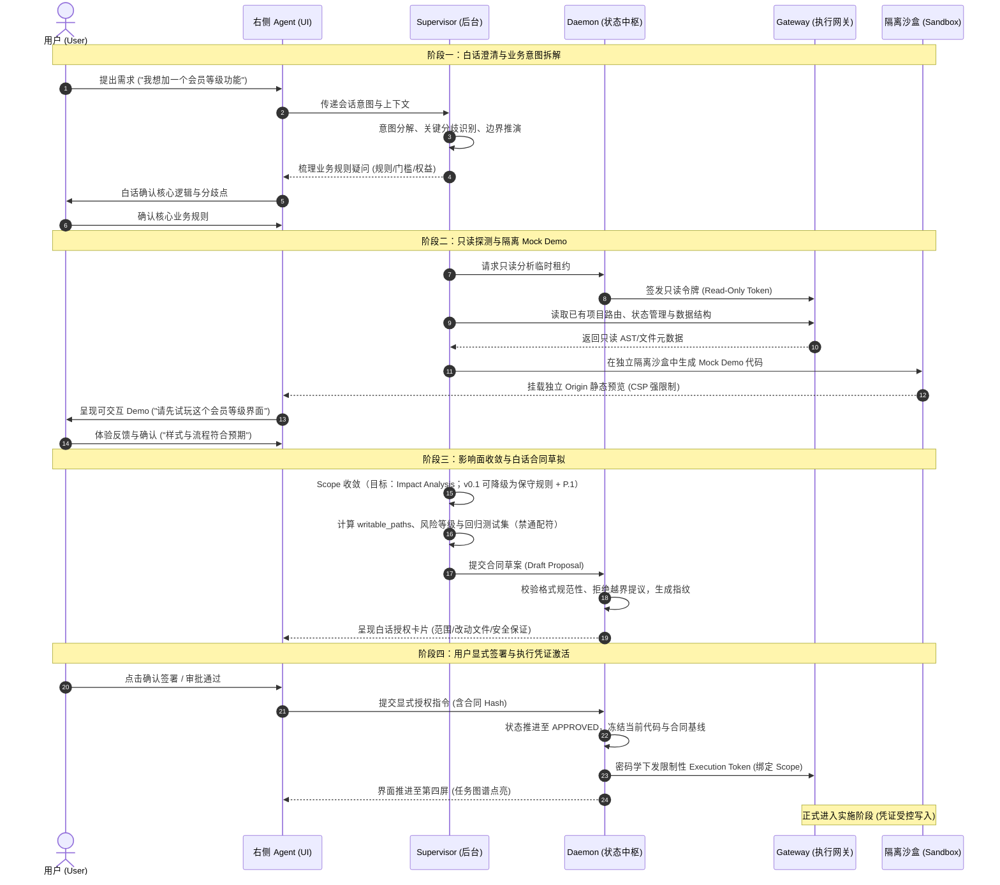

# Stagent 需求澄清与授权流程规范 (Clarification & Authorization Specification)
**版本**: v1.0.0-draft  
**状态**: **讨论稿 / 已入库 reports · 未升格为施工依据**  
**不作为**：任务卡 Scope、验收标准或「代码已实现」的证据。立卡前须对照《决策记录对账-2026-10-25》与合同说明 §7.5。  
**关联基准**:
- 《Stagent 系统架构设计规范 v1.6.1》（宪法；本文不改其正文）
- 《Stagent 研发任务拆解与工程执行规范 v1.6.2》（任务卡；本文不代立卡）
- 《合同设计说明-2026-10-25》（导言 / §7.3–§7.5）
- 《Supervisor运转机制-2026-10-25》（定稿；冲突时以定稿为准）

> **收紧注记（2026-10-25）**  
> 1. **Impact Analysis**：文中「影响面推导 / AST」属**目标能力**；v0.1 可降级为保守 Scope + P.1，完整 AST = **v0.2+**（合同说明 §7.3.5 / §7.5 #7 = 未实现）。  
> 2. **Execution Token / 只读租约 / 新事件名**：对接目标名词，**不暗示** JWT/gRPC 已落地。  
> 3. **仓库中不存在**《产品体验与技术底座设计规范 v1.1》——勿再引用为正式路径。  
> 4. 质询超时：**不静默放行**（见 Supervisor 定稿 §5.2）。

---

## 1. 概述与核心术语

本规范定义 Stagent 在用户发起需求时，从“自然语言对话”到“隔离演示体验”，再到“白话合同拟定”与“显式签署授权”的端到端交互协议、安全权限边界与状态转换机制。

### 1.1 核心角色与组件定义
- **用户 (User)**: 系统最终决策人。通过自然语言表达诉求，体验 Mock Demo，签署白话合同，并对交付物进行验收或拒绝。
- **产品界面 Agent (Right-Panel Agent / Chat UI)**: 面向用户的交互前端与对话助理。负责亲和、白话的情感沟通与诉求接收，将用户的模糊想法转变为结构化要点。
- **后台监理引擎 (Supervisor)**: 系统的中枢思考与分析大脑。具备只读代码理解、依赖影响分析、隔离 Mock Demo 生成、对抗性自查与白话合同草拟能力。**在用户正式授权前，Supervisor 绝无项目源码写权限**。
- **系统核心守护进程 (Daemon)**: 系统状态与物理资产的唯一权威裁决者。负责校验合同规范性、冻结代码基线、核验物理指纹、派发执行凭证及调度沙盒生命周期。
- **执行安全网关 (Execution Gateway)**: 命令执行与文件写入的物理拦截网关。基于 Daemon 签发的动态凭证（Execution Token）实施强制访问控制，拦截越界路径、越权网络出口及越界指令。
- **隔离沙盒 (Sandbox)**: 独立于宿主机工作区与项目源码的临时受限运行环境。用于运行只读探测脚本、编译与托管 Mock Demo，以及后续合同履约施工。

### 1.2 核心资产定义
- **白话合同提案 (Contract Proposal)**: 由 Supervisor 草拟、用户可读的执行方案。包含本轮改动范围、预期影响、安全下限、测试验收集及可写路径（`writable_paths`）。
- **执行凭证 (Execution Token)**: 用户显式签署后由 Daemon 密码学签发的临时凭证。网关凭借该凭证对每一次文件修改与命令调用进行物理白名单校验。
- **隔离 Mock Demo**: 基于只读探测与通用前端模板构建的轻量静态原型。运行在受限隔离 Origin 下，供用户在写代码前先行体验交互与界面感官。

---

## 2. 端到端需求澄清与授权时序

系统在进入真实代码修改前，严格遵循以下四阶段协同流程：
1. **阶段一：白话澄清与业务拆解**
2. **阶段二：只读代码分析与原型伴生**
3. **阶段三：影响分析与合同起草**
4. **阶段四：用户授权与凭证下发**

### 2.1 端到端交互时序图



---

## 3. 签署前后权限矩阵与硬性不变量

为杜绝“AI 自作主张修改代码”、“过度索权”与“环境污染”，系统以**用户签署合同**为绝对分水岭，实行物理级的安全权限切分。

### 3.1 签署前后组件权限比对矩阵

| 组件 / 维度 | 用户签署前 (澄清、分析与 Demo 期) | 用户签署后 (履约与实施期) |
| :--- | :--- | :--- |
| **Supervisor** | • **允许**: 只读代码检索、AST 解析、草拟 Demo、起草合同提案、发起自查质询。<br>• **禁止**: 任何形式的项目代码写入、调用写接口、跳过用户审批。 | • **允许**: 在隔离 Worktree 内指挥实施 Agent 编写代码、生成改动补丁、执行测试。<br>• **禁止**: 擅自修改未授权路径、修改合同本身、直接合并至主干。 |
| **Daemon** | • **允许**: 登记会话状态、调度只读租约、预热隔离沙盒、校验合同格式。<br>• **禁止**: 下发任何具备写权限的 Execution Token。 | • **允许**: 冻结基线、签发限权 Execution Token、监听物理事件、裁决 Graph 节点状态。<br>• **禁止**: 接受未经用户签署的 Token 请求、篡改已冻结合同。 |
| **Gateway (执行网关)** | • **允许**: 拦截并放行只读文件访问；允许隔离沙盒内部临时文件的读写。<br>• **禁止**: 拦截所有针对项目主干工作区的 `write` / `delete` / `patch` 请求。 | • **允许**: 依据 Execution Token 严格放行 `writable_paths` 内的文件写入与受限命令。<br>• **禁止**: 拦截任何越界路径写入（报警 `E_OUT_OF_SCOPE`）、拦截未授权网络请求。 |
| **隔离沙盒 (Sandbox)** | • **允许**: 挂载临时前端模板、生成 Mock Demo，静态资源以独立隔离 Origin 提供预览（CSP 禁用危险特权）。<br>• **禁止**: 访问宿主机敏感路径、访问主项目 Git 仓库。 | • **允许**: 挂载独立 Git Worktree、执行构建、运行自动化测试套件。<br>• **禁止**: 跨越容器命名空间、越权网络 Egress。 |
| **文档与数据资产** | • **状态**: `requirements.md` 为 `DRAFT` 提案，仅保存在临时会话缓存中。 | • **状态**: `requirements.md` 固化为 `FROZEN`，计算 SHA-256 并永久绑定至当次合同。 |

### 3.2 系统的硬性不变量 (Invariants)
1. **零无授权写入 (Zero Unauthorized Writes)**: 在 Daemon 记录到合法的用户签署事件之前，项目工作区物理文件系统改动必须为严格的 0 字节。
2. **最小权限原则 (Least Privilege Scope)**: `writable_paths` 只能是通过影响分析推导出的最小必要集合，任何通配符（如 `src/**` 或 `*`）在合同审核阶段将被 Daemon 直接拒批。
3. **提案与裁决解耦 (Separation of Proposal and Enforcement)**: Supervisor 只能提出建议，没有批准权；Daemon 拥有裁决权，但不直接生成代码。
4. **演示不污染项目 (Demo Isolation)**: Mock Demo 的源码与依赖绝不得进入目标项目的 `package.json` 或主工程代码树中。

---

## 4. 全流程实战案例：给系统增加“会员等级”功能

以下以典型业务诉求“给现有系统增加会员等级功能”为例，展示本规范各环节的执行细节。

### 4.1 步骤 1：白话需求澄清与意图对齐
* **用户输入**: “我想在系统里增加会员等级功能，分为普通、黄金和铂金会员，不同等级有不同折扣。”
* **右侧 Agent 与 Supervisor 交互**:
  * Agent 捕捉到 3 个业务分歧点：
    1. 会员等级是系统内固定配置还是管理员可在后台动态添加？
    2. 等级评定依据是什么（累计消费金额、积分还是手动设置）？
    3. 折扣是在结算页面自动计算，还是需要领券？
  * Agent 转换成用户友好的自然语言提问：“这个等级目前是固定 3 级，还是后续需要支持自定义？另外，用户的等级是根据消费金额自动升级，还是管理员手动调整？”
* **用户澄清回复**: “固定 3 级就行，按累计消费满 500 元升黄金、满 2000 元升铂金。结账时系统自动打折。”

### 4.2 步骤 2：只读影响分析与最小 Scope 推导
* **Supervisor 动作**（Impact = 目标；v0.1 可用机械/关键词保守圈选 + P.1 补漏）:
  * 申请只读分析，检索现有项目代码树：
    * 发现用户表位于 `src/types/user.ts`
    * 发现结账总价计算逻辑位于 `src/lib/checkout.ts`
    * 发现个人中心信息展示位于 `src/components/profile/UserInfo.tsx`
    * 发现订单结算组件位于 `src/components/checkout/OrderSummary.tsx`
  * 推导改动范围，确定影响面爆炸半径：
    * **核心改动路径**: 4 个文件
    * **只读依赖路径**: `src/lib/api.ts`, `src/types/order.ts`
    * **保护区域 (严禁修改)**: `src/auth/*`, `src/server/payments/*` (支付网关核心)

### 4.3 步骤 3：伴生隔离 Mock Demo 体验
* **Supervisor & 沙盒动作**:
  * Supervisor 在独立沙盒内生成独立的静态 Mock 页面（不改动项目代码）：
    * 包含一个可拖动的“累计消费模拟滑块”（0 ~ 3000 元）；
    * 随滑块变化，页面展示个人徽章变更为“黄金会员 (95折)”或“铂金会员 (88折)”；
    * 提供模拟购物车页面，直观呈现原始价格与会员折后价。
  * 沙盒启动独立 Origin 预览端口，Agent 在界面推送：“我做了一个交互原型，你可以拖动测试升级规则和结账折算效果，确认这是你想要的方式吗？”
* **用户体验**: 用户点击试玩，发现 95 折与 88 折的视觉徽章与结算计算符合预期，回复：“确认，就是这个交互。”

### 4.4 步骤 4：生成白话合同卡片
Daemon 校验 Supervisor 提交的提案，并在前端呈现《白话授权卡》：

```markdown
📋 【施工合同】增加会员等级与结账折扣 (Contract #c_mem_001)

🎯 交付目标：
1. 用户系统支持普通、黄金（满500元/95折）、铂金（满2000元/88折）三种等级。
2. 结算页面自动识别用户当前等级并呈现优惠明细。

🛡️ 影响范围与安全保证：
- 允许修改的文件 (4个)：
  • src/types/user.ts (补充会员类型字段)
  • src/lib/checkout.ts (补充等级折扣算法)
  • src/components/profile/UserInfo.tsx (展示会员徽章)
  • src/components/checkout/OrderSummary.tsx (显示会员减免金额)
- 受保护区域：支付结算网关底层与用户认证模块完全受保，不会做任何触碰。

🧪 验收测试计划：
- 新增单元测试：测试 499元、500元、1999元、2000元边界值的等级判定与折扣算法。
- 既有功能回归：确保原有匿名用户结账与普通商品优惠券抵扣不受影响。

[ 签署合同并授权开始实施 ]  [ 修改需求细节 ]
```

### 4.5 步骤 5：用户签署与凭证生效
* 用户点击 `[ 签署合同并授权开始实施 ]`。
* **Daemon 响应**:
  1. 记录签署事件与时间戳，冻结需求快照 `requirements.md`（状态变更为 `FROZEN`）；
  2. 针对 Git 当前 HEAD 创建受限 Worktree 分支 `worktree/contract-c_mem_001`；
  3. 签发限权执行许可（对接目标名 `ExecutionToken`；具体形态待 API Top5 决议），白名单路径严格绑定为上述 4 个文件；
  4. 唤醒实施引擎，任务图谱切入第四屏，首个节点点亮并开始执行。

---

## 5. 待补充与待决议项 (Open Decisions)

为了使本规范能够直接指导前后端代码与自动化测试编写，目前仍需补充并决议以下关键技术细节：

### 5.1 待决议 1：执行凭证 (Execution Token) 的具体格式与校验机制
* **当前现状**: 仅定义了“Daemon 签发、Gateway 拦截”，缺乏具体的底层实现机制。
* **待定选项**:
  - **选项 A**: JWT 签名令牌（携带 `exp`, `contract_id`, `writable_paths`, `allowed_commands` 等 Claim，Gateway 本地使用 Daemon 公钥验签）。
  - **选项 B**: Daemon 内存共享 Session / 双向 gRPC 实时鉴权（Gateway 每执行一次文件 IO 或 Shell 调用，均向 Daemon 进程 RPC 询问）。
* **影响面**: 决定了 Gateway 的性能开销及沙盒进程异常崩溃后的凭证撤销能力。

### 5.2 待决议 2：Mock Demo 的代码与状态持久化生命周期
* **当前现状**: 定义了在独立 Origin 预览，但未明确用户满意或放弃后 Demo 代码的去向。
* **待定选项**:
  - **选项 A**: 纯即弃型（Ephemeral）：仅存在于临时沙盒内存或 `/tmp`，合同签署后立即销毁，项目代码从零编写。
  - **选项 B**: 资产沉淀型（Assetized）：Demo 代码存档在 `.stagent/prototypes/<id>`，作为后续 UI 实施 Agent 的代码生成与视觉对齐参考资产。
* **影响面**: 影响磁盘占用、设计一致性以及是否能在后续返工时重新查看旧原型。

### 5.3 待决议 3：需求澄清阶段的多轮分歧收敛上限
* **当前现状**: 依赖 Agent 与用户自然语言沟通，缺乏收敛指标。
* **待定选项**:
  - **选项 A**: 限制最大澄清轮次（如最多主动提问 2 轮，未决细节按安全默认推荐并标注在合同中供用户一键确认）。
  - **选项 B**: 动态置信度打分（Supervisor 计算意图清晰度评分，达到 85 分以上方允许起草合同，否则继续询问）。
* **影响面**: 决定了非技术用户的沟通疲劳度与交付偏差控制之间的平衡。

### 5.4 待决议 4：合同草案拒绝与返工流转规范
* **当前现状**: 用户点击“修改需求细节”或直接拒绝合同时，系统的回退路径未规范化。
* **待定选项**:
  - 需明确：回退是保留 Mock Demo 继续修改，还是重新进行只读代码分析？合同版本号递增规则（如 `v1.0-draft` → `v1.1-draft`）与会话快照归档机制。

