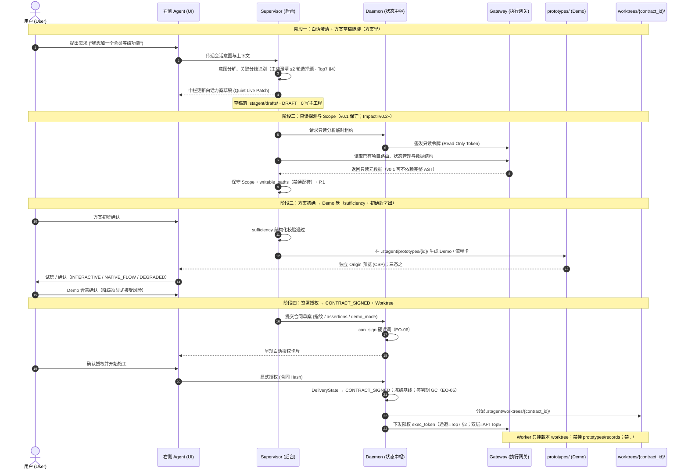

# Stagent 需求澄清与授权流程规范 (Clarification & Authorization Specification)
**版本**: v1.0.0-draft  
**状态**: **讨论稿 / 已入库 reports · 未升格为施工依据**  
**消歧对齐（2026-10-26）**: 本文已与 tip **`fb6167d`** 前序消歧（Top7 + 右栏 §8～§13 / DEC / EO-01～10 CLOSED）对齐；同日 Tina 将 **API Top5 As-is→To-be** 收口为 **CLOSED 定案条款**（见本文 **§6** 与《Stagent_Interface_Contract_Checklist_v1.0》§3）。原「Schema 待拍 / 待决议」残留已核销为交叉引用。**仍为讨论稿，未升格、未立卡**；**CLOSED ≠ 已实现**。  
**不作为**：任务卡 Scope、验收标准或「代码已实现」的证据。立卡前须对照《决策记录对账-2026-10-25》与合同说明 §7.5。  
**关联基准**:
- 《Stagent 系统架构设计规范 v1.6.1》（宪法；本文不改其正文）
- 《Stagent 研发任务拆解与工程执行规范 v1.6.2》（任务卡；本文不代立卡）
- 《合同设计说明-2026-10-25》（导言 / §7.3–§7.5）
- 《Supervisor运转机制-2026-10-25》（定稿；冲突时以定稿为准）
- 《工程决策拍板-Top7-2026-10-25》（七条硬标准；冲突时本纪要 > 本文旧「待决议」）
- 《Supervisor右栏对话行为-设计-2026-10-26》（讨论稿；**§0 / §8～§13 / DEC-01～06 / EO-01～10 CLOSED**；冲突时以该稿 CLOSED 条款为准，本文不得另开选择题）
- 《Stagent_Interface_Contract_Checklist_v1.0》（同目录讨论稿；**API Top5 CLOSED**；冲突时以 Top5 定案 + EO 为准）

> **收紧注记（2026-10-25 · 2026-10-26 消歧修订 · Top5 定案）**  
> 1. **Impact Analysis**：文中「影响面推导 / AST」属**目标能力**；**v0.1 = 保守 Scope + P.1**，完整 AST = **v0.2+**（合同说明 §7.3.5 / §7.5 #7 = 未实现）。图注与案例一律按此标注，不得暗示 v0.1 已具备 AST Impact。  
> 2. **Execution Token**：**通道** = Top7 §2；**双层令牌 + Schema 草稿** = **API Top5 #1 CLOSED**（§6.1 / EO-07）。**不再**作为本文 Open Decision；**CLOSED ≠ 已实现**。  
> 3. **仓库中不存在**《产品体验与技术底座设计规范 v1.1》——勿再引用为正式路径。  
> 4. 质询超时：**不静默放行**（见 Supervisor 定稿 §5.2）。  
> 5. **越界处置**：Top7 §3（阻断 + `PAUSED` + 问人）+ **API Top5 #3 CLOSED**（原子拦截：SIGINT 软停 3s → 超时 SIGKILL → 吊销 `exec_token` → 清锁文件；**禁止静默放行**）。勿另写「仅弹窗放行」或「默认立刻 kill -9」。  
> 6. **交付主状态**：废除以 `APPROVED` / `FROZEN` 作为主交付态叙事；对齐右栏 **EO-01 `DeliveryState`**；广播态须带 **`session_epoch` + `state_seq`**（**API Top5 #2 CLOSED**）。资产文件可仍有「草稿 / 签署冻结快照」语义，但不得冒充 DeliveryState。

---

## 1. 概述与核心术语

本规范定义 Stagent 在用户发起需求时，从“自然语言对话”到“方案草稿随聊生成”，再到“隔离 Demo / 流程卡体验”“白话合同拟定”与“显式签署授权”的端到端交互协议、安全权限边界与状态转换机制。

**时间闸（与右栏 §11 对齐 · 方案早、Demo 晚）**：方案草稿可随聊平静生成；**Demo 绝不提前生成**，必须同时满足：① 机器规则判定 `sufficiency`；② 用户完成方案初步确认。真写主工程 / Worktree 仅在 Demo 合意确认 + 白话合同签署之后。

### 1.1 核心角色与组件定义
- **用户 (User)**: 系统最终决策人。通过自然语言表达诉求，确认方案草稿，体验 Demo / 流程卡，签署白话合同，并对交付物进行验收或拒绝。
- **产品界面 Agent (Right-Panel Agent / Chat UI)**: 面向用户的交互前端与对话助理。负责亲和、白话的情感沟通与诉求接收，将用户的模糊想法转变为结构化要点。
- **后台监理引擎 (Supervisor)**: 系统的中枢思考与分析大脑。具备只读代码理解、依赖影响分析（v0.2+）、隔离 Demo / 流程卡生成、对抗性自查与白话合同草拟能力。**在用户正式授权前，Supervisor 绝无项目源码写权限**；澄清期草稿仅可写入 `.stagent/drafts/`（见 EO-02）。
- **系统核心守护进程 (Daemon)**: 系统状态与物理资产的唯一权威裁决者。负责校验合同规范性、冻结签署基线、核验物理指纹、派发 / 吊销执行凭证及调度沙盒与 Worktree 生命周期（对齐 EO-01 / EO-05 / EO-07）。
- **执行安全网关 (Execution Gateway)**: 命令执行与文件写入的物理拦截网关。基于 Daemon 签发的动态凭证（Execution Token）实施强制访问控制；越界按 **Top7 §3** 阻断并置 `PAUSED`，不静默放行。
- **隔离沙盒 (Sandbox)**: 独立于宿主机工作区与项目源码的临时受限运行环境。澄清 / 试玩期用于托管 **`.stagent/prototypes/`** 下的 Demo；签署后施工期 Worker **只挂载** **`.stagent/worktrees/{contract_id}/`**——**prototypes ≠ worktrees**（见 EO-02）。

### 1.2 核心资产定义
- **白话方案草稿 / 合同提案 (Plan Draft / Contract Proposal)**: 中栏给人看的白话短方案与可签署提案。草稿落盘于 **`.stagent/drafts/`**（DRAFT；未签无主仓库写权）。提案含本轮改动范围、预期影响、安全下限、测试验收集及可写路径（`writable_paths`）。
- **执行凭证 (Execution Token)**: 用户显式签署后由 Daemon 签发的临时凭证。**校验通道** = Top7 §2（内存级轻量 Token + 本地 IPC；v0.1 同进程 Gateway 校验亦可，Tina 未强制 Domain Socket）。**双层体系（API Top5 #1 CLOSED / EO-07）**：外部保持 `session-token` 鉴权；内部施工通道签发绑定 `contract_id`+`worktree` 的 `exec_token`；`PAUSED` 硬吊销；恢复下发一次性带 `jti` 的 `resume_token`。字段级 Schema 草稿见 Checklist 附录；**CLOSED ≠ 已实现**。
- **隔离 Demo 资产**: 试玩期生成并运行在 **`.stagent/prototypes/{prototype_id}/`**（`.gitignore`；不合入主干）。三态（右栏 EO-06 / DEC-02）：`INTERACTIVE_DEMO` / `NATIVE_FLOW_CARD` / `DEGRADED_FLOW_CARD`。签署后门禁见 `can_sign`；施工 Worker **不得**挂载 / 修改该目录。

---

## 2. 端到端需求澄清与授权时序

系统在进入真实代码修改前，严格遵循「**方案早、Demo 晚**」四阶段协同流程（与右栏 §11 / §14 对齐）：
1. **阶段一：白话澄清与方案草稿随聊生成**（可早出 DRAFT；落 `.stagent/drafts/`）
2. **阶段二：只读代码分析与 Scope 收敛**（v0.1 = 保守 Scope + P.1；完整 Impact Analysis = v0.2+）
3. **阶段三：方案初确 → sufficiency 通过后生成 Demo / 流程卡 → 用户确认**（三态分立；不得提前出 Demo）
4. **阶段四：白话合同签署与凭证 / Worktree 下发**（`CONTRACT_SIGNED`；路径 `.stagent/worktrees/{contract_id}/`）

### 2.1 端到端交互时序图



---

## 3. 签署前后权限矩阵与硬性不变量

为杜绝“AI 自作主张修改代码”、“过度索权”与“环境污染”，系统以**用户签署合同**为绝对分水岭，实行物理级的安全权限切分。

### 3.1 签署前后组件权限比对矩阵

| 组件 / 维度 | 用户签署前 (澄清、方案草稿与 Demo 期) | 用户签署后 (履约与实施期) |
| :--- | :--- | :--- |
| **Supervisor** | • **允许**: 只读代码检索、草拟方案（`.stagent/drafts/`）、在 **prototypes/** 生成 Demo / 流程卡、起草合同提案、发起自查质询。<br>• **禁止**: 任何形式的项目主干代码写入、调用写接口、跳过用户审批、提前于 sufficiency+初确生成 Demo。 | • **允许**: 在 **`.stagent/worktrees/{contract_id}/`** 内指挥实施 Agent 编写代码、生成改动补丁、执行测试。<br>• **禁止**: 擅自修改未授权路径、修改合同本身、直接合并至主干、访问 / 改写 `prototypes/` 或 `records/`。 |
| **Daemon** | • **允许**: 登记会话状态（EO-01）、调度只读租约、管理 drafts/prototypes、校验合同格式与 `can_sign`。<br>• **禁止**: 下发任何具备写权限的 Execution Token；把流程卡记成可交互 Demo。 | • **允许**: 推进 `CONTRACT_SIGNED`、冻结签署基线、签发 / 吊销 Token（EO-07）、分配 worktree、裁决交付态至 `MERGED`/`DELIVERED`（EO-05）。<br>• **禁止**: 接受未经用户签署的写 Token 请求、篡改已签合同快照、归档失败仍标 `DELIVERED`。 |
| **Gateway (执行网关)** | • **允许**: 拦截并放行只读文件访问；允许 **prototypes/** 沙盒内临时文件读写。<br>• **禁止**: 拦截所有针对项目主干工作区的 `write` / `delete` / `patch` 请求。 | • **允许**: 依据 Execution Token 严格放行 `writable_paths` 内、且位于本 worktree 内的写入与受限命令。<br>• **禁止**: 越界路径写入 → **Top7 §3** + **API Top5 #3 CLOSED**：阻断当次 IO + 原子拦截（SIGINT 软停 3s 释锁 → 超时 SIGKILL → 吊销 `exec_token` → 清锁文件）+ `PAUSED` + 告警问人（**禁止静默放行**）。 |
| **隔离运行区** | • **Demo 区 = `.stagent/prototypes/{prototype_id}/`**：独立 Origin / CSP；**不是**施工 Worktree。<br>• **禁止**: 访问宿主机敏感路径、把 Demo 依赖写入主工程 `package.json`。 | • **施工区 = `.stagent/worktrees/{contract_id}/`**：Worker **仅且只**挂载该目录（EO-02）；禁符号链接穿出、禁 `../`。<br>• **禁止**: 将 `prototypes/` 或 `records/` 挂进 Worker 沙盒。 |
| **文档与数据资产** | • **状态**: 方案 / `requirements` 等为 **DRAFT**，落 **`.stagent/drafts/`**（Git 门禁豁免；gitignore ≠ 安全边界）。 | • **签署时**: 冻结当前版快照并算 `spec_sha256`（Pre-Execution Freeze & GC，见右栏补钉-3 / EO-05）；DeliveryState → **`CONTRACT_SIGNED`**（**不用** `APPROVED`/`FROZEN` 作主交付态）。<br>• **验收合并后**: `MERGED` → 脱敏归档入 `.stagent/records/{contract_id}/` → 成功才 **`DELIVERED`**（两阶段归档；EO-04 / EO-05 / EO-10）。 |

### 3.2 系统的硬性不变量 (Invariants)
1. **零无授权写入 (Zero Unauthorized Writes)**: 在 Daemon 记录到合法的用户签署事件之前，项目工作区物理文件系统改动必须为严格的 0 字节（`.stagent/drafts/` 与 `.stagent/prototypes/` 除外，且二者不得进入主干）。
2. **最小权限原则 (Least Privilege Scope)**: `writable_paths` 只能是通过影响分析（v0.1=保守规则）推导出的最小必要集合，任何通配符（如 `src/**` 或 `*`）在合同审核阶段将被 Daemon 直接拒批。
3. **提案与裁决解耦 (Separation of Proposal and Enforcement)**: Supervisor 只能提出建议，没有批准权；Daemon 拥有裁决权，但不直接生成代码。
4. **演示不污染项目 (Demo Isolation)**: Demo 源码与依赖绝不得进入目标项目的 `package.json` 或主工程代码树；持久化仅在 `.stagent/prototypes/`（Top7 §1）。
5. **prototypes ≠ worktrees (EO-02)**: 试玩资产与施工 Worktree 物理分立；Worker 只挂载 `.stagent/worktrees/{contract_id}/`；`.gitignore` 不承担访问控制。
6. **脱敏入盘 (EO-04 / EO-10)**: v0.1 不落明文原文；持久化审计流须经 L1+L2 脱敏管道；「永久保留」指脱敏后完整记录，不是未处理原文。

---

## 4. 全流程实战案例：给系统增加“会员等级”功能

以下以典型业务诉求“给现有系统增加会员等级功能”为例，展示本规范各环节的执行细节（**方案早、Demo 晚**）。

### 4.1 步骤 1：白话需求澄清与方案草稿（可早）
* **用户输入**: “我想在系统里增加会员等级功能，分为普通、黄金和铂金会员，不同等级有不同折扣。”
* **右侧 Agent 与 Supervisor 交互**:
  * Agent 捕捉到 3 个业务分歧点，并按 **Top7 §4** 收敛为带唯一推荐项的白话选择题（主动澄清 ≤ 2 轮；未决细项用安全默认写入合同供一键确认）：
    1. 会员等级是系统内固定配置还是管理员可在后台动态添加？
    2. 等级评定依据是什么（累计消费金额、积分还是手动设置）？
    3. 折扣是在结算页面自动计算，还是需要领券？
  * Agent 转换成用户友好的自然语言提问：“这个等级目前是固定 3 级，还是后续需要支持自定义？另外，用户的等级是根据消费金额自动升级，还是管理员手动调整？”
* **用户澄清回复**: “固定 3 级就行，按累计消费满 500 元升黄金、满 2000 元升铂金。结账时系统自动打折。”
* **中栏**: 随聊更新白话方案草稿（DRAFT → `.stagent/drafts/`）；**此时不出 Demo**。

### 4.2 步骤 2：只读影响分析与最小 Scope 推导
* **Supervisor 动作**（**Impact Analysis = v0.2+ 目标**；**v0.1 = 机械/关键词保守圈选 + P.1 补漏**）:
  * 申请只读分析，检索现有项目代码树：
    * 发现用户表位于 `src/types/user.ts`
    * 发现结账总价计算逻辑位于 `src/lib/checkout.ts`
    * 发现个人中心信息展示位于 `src/components/profile/UserInfo.tsx`
    * 发现订单结算组件位于 `src/components/checkout/OrderSummary.tsx`
  * 推导改动范围，确定影响面爆炸半径（v0.1 保守）：
    * **核心改动路径**: 4 个文件
    * **只读依赖路径**: `src/lib/api.ts`, `src/types/order.ts`
    * **保护区域 (严禁修改)**: `src/auth/*`, `src/server/payments/*` (支付网关核心)

### 4.3 步骤 3：方案初确 → 再出隔离 Demo（Demo 晚）
* **前置闸门**: 用户对中栏方案点「大致对」+ 机器 `sufficiency` 通过（右栏 §11）后，才允许生成 Demo。
* **Supervisor & prototypes 动作**:
  * 在 **`.stagent/prototypes/{prototype_id}/`** 生成独立静态 Mock（不改动项目代码、不进 worktree）：
    * 包含一个可拖动的“累计消费模拟滑块”（0 ~ 3000 元）；
    * 随滑块变化，页面展示个人徽章变更为“黄金会员 (95折)”或“铂金会员 (88折)”；
    * 提供模拟购物车页面，直观呈现原始价格与会员折后价。
  * 本例为 **`INTERACTIVE_DEMO`**；若纯后端任务则走 **`NATIVE_FLOW_CARD`**（非降级）；构建失败才走 **`DEGRADED_FLOW_CARD`**（须显式接受风险 + 合同 ⚠️）。
  * Agent 推送：“我做了一个交互原型，你可以拖动测试升级规则和结账折算效果，确认这是你想要的方式吗？”
* **用户体验**: 用户试玩后回复：“确认，就是这个交互。”（写入对应 `DemoConfirmationEvent`，供后续 `can_sign`）

### 4.4 步骤 4：生成白话合同卡片
Daemon 校验 Supervisor 提交的提案（含 `demo_mode` 与确认事件匹配），并在前端呈现《白话授权卡》：

```markdown
📋 【施工合同】增加会员等级与结账折扣 (Contract #c_mem_001)

🎯 交付目标：
1. 用户系统支持普通、黄金（满500元/95折）、铂金（满2000元/88折）三种等级。
2. 结算页面自动识别用户当前等级并呈现优惠明细。

🛡️ 影响范围与安全保证：
- 允许修改的文件 (4个)：
  • src/types/user.ts (补充会员类型字段)
  • src/lib/checkout.ts (补充等级折扣算法)
  • src/components/profile/UserInfo.tsx (展示会员徽章)
  • src/components/checkout/OrderSummary.tsx (显示会员减免金额)
- 受保护区域：支付结算网关底层与用户认证模块完全受保，不会做任何触碰。
- Demo 模式：INTERACTIVE_DEMO（已试玩确认）

🧪 验收测试计划：
- 新增单元测试：测试 499元、500元、1999元、2000元边界值的等级判定与折扣算法。
- 既有功能回归：确保原有匿名用户结账与普通商品优惠券抵扣不受影响。

[ 签署合同并授权开始实施 ]  [ 修改需求细节 ]
```

* **拒约 / 改细节**：默认**保留** Demo 与会话上下文继续改（**Top7 §5**）；仅业务流程大改或 Scope 剧烈扩散时重跑只读分析 / 重做 Demo；草案版本按草稿递增（如 `v1.0-draft` → `v1.1-draft`），签署前旧草案标 `SUPERSEDED`。

### 4.5 步骤 5：用户签署与凭证生效
* 用户点击 `[ 签署合同并授权开始实施 ]`。
* **Daemon 响应**（对齐 EO-01 / EO-05 / EO-02 / Top7 §2）:
  1. 记录签署事件与时间戳；冻结需求快照并计算 `spec_sha256`；DeliveryState → **`CONTRACT_SIGNED`**（**不以** `APPROVED`/`FROZEN` 作为主交付态）；
  2. 签署期 GC：仅清当前合同可重建临时缓存（不得清活跃 Demo、已校验签署快照、中栏仍引用的 drafts 正文）；
  3. 分配施工目录 **`.stagent/worktrees/{contract_id}/`**（本例即 `.stagent/worktrees/c_mem_001/`）；Worker 只挂载该路径；
  4. 签发限权执行许可：通道 = **Top7 §2**；双层 = **API Top5 #1 CLOSED**（外部 `session-token` + 内部 `exec_token` 绑定本 `contract_id`/worktree；Schema 草稿见 Checklist 附录）；白名单路径严格绑定为上述 4 个文件；
  5. 唤醒实施引擎进入 `IMPLEMENTING`；后续验收合并后走 `MERGED` → 脱敏归档 `records/` → `DELIVERED`（失败停在 `MERGED`，不伪标交付）。

---

## 5. 已被 Top7 + 右栏 DEC/EO 取代的原「待决议」（不再开放选择题）

> **口径**：下列四条原 Open Decisions **已全部被取代**；本文**不再**保留 A/B 选项供再选。字段级 Token Schema / 重连序列 / 越界原子拦截 / Demo 三态门禁 / 无 Git 审计清单等，已由 **API Top5 CLOSED（§6）** + 右栏 **EO** 收口为规范正文定案；**CLOSED ≠ 已实现**；**不**再回写为本澄清稿的开放决议。

### 5.1 原「待决议 1」：Execution Token 格式与校验 → **已被取代（已定案）**
* **通道（产品/工程硬标准）**: 《工程决策拍板-Top7》**§2** — **内存级轻量 Token + 本地 IPC**（Daemon 权威；v0.1 同进程 Gateway 校验 OK；Domain Socket 非强制）。**不采用（v0.1）** 纯离线 JWT 作为唯一撤销通道。
* **双层令牌 + 暂停/恢复**: **API Top5 #1 CLOSED** + 右栏 **EO-07** — 外部 `session-token` + 内部 `exec_token`（绑定 `contract_id`+worktree）；`PAUSED` 硬吊销；恢复下发一次性带 `jti` 的 `resume_token`；旧凭证一律拒绝。
* **Schema / Claim 草稿**: **已定案（CLOSED）** — 见本文 **§6.1** 与 Checklist 附录 `ExecToken` / `ResumeToken`；**不是**开放选择题；**CLOSED ≠ 已实现**（不暗示 JWT/gRPC 已落地）。

### 5.2 原「待决议 2」：Mock Demo 持久化生命周期 → **已被取代（已定案）**
* **归宿**: Top7 **§1** + 右栏 **DEC-01 / 补钉-4 / EO-02** — 活跃态存 **`.stagent/prototypes/{prototype_id}/`**，gitignore，不合入主干。
* **三态与门禁**: 右栏 **DEC-02 / EO-06** + **API Top5 #4 CLOSED** — 确认事件升级为 `demo_mode` 三态结构体；入库校验 `can_sign` 硬谓词（阻断流程卡偷渡为交互 Demo）；降级须显式接受并带 ⚠️。
* **流转**: 签署后 prototypes 只读作 Golden Benchmark；验收合并后轻量无依赖拷贝进 **`.stagent/records/{contract_id}/`**（EO-05 / Top5 #4）；**prototypes ≠ worktrees**。
* **废止**: 「纯即弃 /tmp」与「进主干」两选项均不再讨论。

### 5.3 原「待决议 3」：澄清轮次上限 → **已被取代（已定案）**
* **标准**: Top7 **§4** — 主动澄清 **≤ 2 轮**；每题为带**唯一推荐项**的白话选择题；未决细项用**安全默认**写入白话合同供一键确认。
* **禁止**: 无休止开放式追问、技术填空卷。
* **与右栏**: sufficiency / 方案初确 / Demo 晚见 **§11（产品 CLOSED）**；不得用「动态置信度分数」替代结构化 sufficiency（§11.2.1）。

### 5.4 原「待决议 4」：拒约 / 改细节回退 → **已被取代（已定案）**
* **标准**: Top7 **§5** — 默认**保留** Demo 与会话上下文继续改；仅业务流程大改或 Scope 剧烈扩散时重跑只读影响分析 / 重做 Demo。
* **版本**: 合同草案按草稿递增（如 `v1.0-draft` → `v1.1-draft`）；签署前旧草案作废或标记 `SUPERSEDED`。
* **放弃本轮**: 右栏 **DEC-03** — 须二次确认；中栏置灰只读截断；非成功终态归档（不得标成已交付三件套）。
* **返工计数**: 右栏 **DEC-05 / EO-08** — 合并前按 `assertion_id` 独立计数；返工期严禁追加新断言；合并后新缺陷必须新微合同。

### 5.5 消歧对照摘要（本文叙事 → 权威条款）

| 本文旧叙事 / 风险点 | 权威收口 |
| :--- | :--- |
| 方案与 Demo「伴生同时出」 | 右栏 **§11**：方案早、Demo 晚 |
| 主交付态 `APPROVED` / `FROZEN` | 右栏 **EO-01**：`CONTRACT_SIGNED` / `MERGED` / `DELIVERED` 等 |
| 草稿只在「临时会话缓存」 | **`.stagent/drafts/`**（§8 / EO-02） |
| Demo 与施工同一沙盒含糊 | **prototypes ≠ worktrees**；Worker 只挂 **`.stagent/worktrees/{contract_id}/`**（EO-02） |
| Demo 单一「可交互」默认 | **EO-06** 三态 + `can_sign` |
| 「永久原声」vs 脱敏字面冲突 | **DEC-01 / EO-04 / EO-10** + 两阶段归档（补钉-3） |
| Token 开 JWT vs gRPC 选择题 | **Top7 §2** 定通道；双层 Schema → **API Top5 #1 CLOSED**（§6.1 / EO-07） |
| 越界怎么处置未写清 | **Top7 §3** + **API Top5 #3 CLOSED**（软停 3s → SIGKILL → 吊销 → 清锁；禁静默放行） |
| 重连后状态乱跳 / 幽灵写入 | **API Top5 #2 CLOSED**（`session_epoch`+`state_seq`；映射 EO-01；seq 去重防倒流） |
| 无 Git 时审计不可证 | **API Top5 #5 CLOSED**（`.stagent/records/{contract_id}/audit-manifest.json`；脱敏后哈希；独立于 Git） |

---

## 6. API Top5 缺口补齐定案（CLOSED · 2026-10-26 · 对齐 EO）

> **状态：CLOSED（规范正文定案）** — Tina 2026-10-26 Asia/Hong_Kong 拍板。  
> **口径**：现网骨架（session-token、全量 STATE 回放、写保护弹窗、prototypes + 布尔确认）**不推翻**；下列五项把「half/none 缺口」映射为最干净的 **Delta 升级卡** 目标收口。**CLOSED ≠ 已实现**；未升格、未立卡。权威字段细节与 Schema 草稿见《Stagent_Interface_Contract_Checklist_v1.0》§3 / 附录。

| # | API Top5 | 现网 As-is | 目标 To-be（定案） | 对应 EO | Delta 方针 |
| :--- | :--- | :--- | :--- | :--- | :--- |
| 1 | Token 凭证 | 仅单层 `session-token`，依赖单进程拦写 | **双层令牌**：外部保持 session 鉴权；内部施工通道引入 `exec_token`（绑定 `contract_id` 与 worktree）；`PAUSED` 时硬吊销；恢复时下发一次性带 `jti` 的 `resume_token` | EO-07 | 升级卡，不推翻现网 session |
| 2 | 状态与重连 | 仅粗粒度全量 `STATE` 全局广播回放 | 引入 `session_epoch` + `state_seq` 递增序列号；广播状态严格映射 **EO-01** 强类型枚举；客户端按 seq 去重、**防倒流** | EO-01 | 升级卡，在现有 STATE 通道上叠序列 |
| 3 | 越界与拦截 | 抛错拦截 + UI 弹窗提示 | **原子化拦截器**：触发越界/中断 → 先发 `SIGINT` 给 **3 秒**软停止释锁 → 超时强制 `SIGKILL` → 吊销当前 `exec_token` → 清理锁文件；**禁止静默放行** | EO-02, EO-07 | 升级卡，补齐弹窗背后的进程/锁语义 |
| 4 | Demo 门禁 | 本地静态目录 + 粗暴布尔确认 | 确认事件升级为 **`demo_mode` 三态结构体**；入库校验 **`can_sign` 硬谓词**（阻断流程卡偷渡为交互 Demo）；合入主干后向 `.stagent/records/` 轻量无依赖复制 | EO-05, EO-06 | 升级卡，不推翻 prototypes 目录 |
| 5 | 无 Git 审计 | 完全缺失 | 落地 **`.stagent/records/{contract_id}/audit-manifest.json`**：脱敏管道后落盘，计算快照与审计事件哈希；**不依赖 Git 提交**独立证明交付物完整性 | EO-03, EO-04, EO-05 | 新建侧车清单；不依赖 Git Trailer |

### 6.1 Token Schema 草稿（定案目标 · 非已实现）

```ts
type ExecToken = {
  jti: string;
  kind: "exec";
  contract_id: string;
  contract_hash: string;
  worktree_root: string;
  scope: { writable_paths: string[]; allowed_commands: string[] };
  egress_policy: unknown;
  issued_at: string;
  expires_at: string;
  session_epoch?: number;
};

type ResumeToken = {
  jti: string;
  kind: "resume";
  contract_id: string;
  replaces_jti: string;
  issued_at: string;
  expires_at: string;
  single_use: true;
  worktree_clean_ok: boolean;
};
```

* **校验**: v0.1 同进程 Gateway 向 Daemon 校验即可（Tina 未要求 Domain Socket）。  
* **`hmac_signature`**: 可选；当 IPC 需 Daemon 实时确认时可附。  
* **废止开放题**: 「Token 是否分级 / JWT vs IPC」「Schema 仍待拍」——本条 **CLOSED**。

### 6.2 与原开放残留交叉核销

| 原残留开放表述（历史） | 核销结果 |
| :--- | :--- |
| Token 是否分级 / JWT vs IPC / Schema 仍待拍 | **CLOSED** → §6.1 + Top5 #1 + EO-07 + Top7 §2 |
| Demo 存放路径 / prototypes vs main / 即弃 vs 归档 | **CLOSED** → §5.2 + Top5 #4 + Top7 §1 + EO-02/05/06 |
| 拒签 / 改细节回退逻辑 | **CLOSED** → §5.4 + Top7 §5 + DEC-03/05 + EO-08 |
| 重连一致性 / epoch·seq 未定 | **CLOSED** → Top5 #2 + EO-01 |
| 越界仅弹窗 vs kill 未定 | **CLOSED** → Top5 #3 + Top7 §3 + EO-07 |
| 无 Git 审计侧车路径未定 | **CLOSED** → Top5 #5（路径定为 `records/{contract_id}/audit-manifest.json`，非旧稿 `metadata/`） |

---

**落定句（讨论稿）**: 澄清授权稿已与 Top7 + 右栏 DEC/EO + **API Top5 CLOSED（§6）** 消歧；原 §5 四条待决议及 Schema「仍待拍」残留全部核销为定案交叉引用；**仍讨论稿，未升格、未立卡**；**CLOSED ≠ 已实现**。下一步（不在本文）：DocGov / Workflow 状态名与 EO-01/02 对齐。
