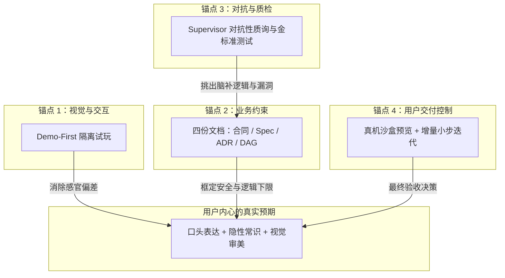
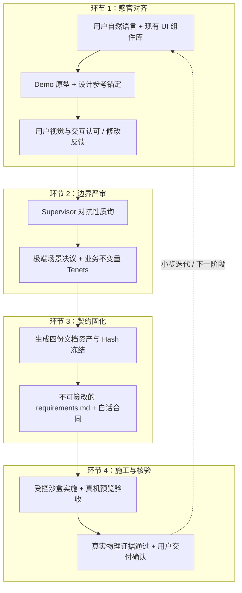

# Supervisor · 右栏对话时做什么（设计稿）

> **日期**：2026-10-26（Asia/Hong_Kong）  
> **状态**：**讨论稿** — 只定「对话时 Supervisor 干什么」；不改《架构规范》《任务规范》正文，不立卡、不动产品代码，除非 Tina「立卡」或「升格」。  
> **澄清结束产物（§8）**：**倾向采纳** — 4 份核心文档草案 + 1 份隔离 Mock Demo；全 DRAFT/PROPOSED，确认前无写权。  
> **文档不够保证「心中产品」（§9）**：**倾向采纳** — 静态文档只定安全下限；体验上限靠四重真实锚点（Demo-First / 设计参考 / 对抗性质询 / 微合同真机预览）。  
> **四锚点闭环 / 隐性逃逸 / 开工门禁 / 微合同（§10）**：**倾向采纳** — 感官→严审→固化→核验递进；5 条编码开工门禁；Micro-Contracts 为非技术交付最优解。v0.1 降级注：Impact 全收敛与「零未决」可收窄 Scope / 拆微步，不挡澄清结束。  
> **方案早、Demo 晚（§11）**：**倾向采纳** — 方案草稿可在需求很少很模糊时随对话自动生成/更新；Demo 不自动过早出——须自动检测「方案足以生成 Demo」且用户对方案**初步确认**后才生成；Demo 合意后再点「符合预期」并签合同，才写真码。  
> **日常方案草稿 vs 机器侧细稿 / 三层决策锁（§12）**：**倾向采纳** — 中栏日常方案 = 给人看的白话短稿；背后可另存更细机器稿（断言草案、影响面笔记、未决清单），默认折叠；签字前仍草案。决策治理用 Tenets 常驻 + ADR 条件触发 + 金标准用例在方案够稳/签合同前后落成，与大规范互补，不每轮硬写满三套。  
> **用户意图锁定**（当日对话）：右栏保持 Cursor 式自由度；**不是**一句愿望直接写真代码；先由 Supervisor 落成**方案 + Demo**；Tina **确认后再**执行真实仓库开发。澄清宜少打断，关键分叉优先收进**方案草稿里的选项**，而不是聊天连珠炮。  
> **本稿依据**：真实软件开发里「需求澄清 / Discovery」怎么走（问题框定 → 现状与目标 → 边界 → 关键决策 → 验收与边角 → 冻结再实施），对照映射到右栏对话；并与 `Supervisor运转机制-2026-10-25.md`、Top7（澄清 ≤2 轮）、合同设计说明、C.11 体感链对齐。  
> **不是**：把 C.11 演示脚本当成产品主流程；演示卡只用来验按钮，日常对话应按下文澄清生命周期运转。

---

## 0. 一句话

**你在右栏像跟产品经理聊需求；Supervisor 按真实澄清阶段在背后写意图要点与方案草稿（可早、可模糊）；方案够具体且你初步确认后才出可点 Demo；只有会改「做不做 / 做到哪 / 怎么算完」的分叉才偶尔打断；Demo 合意并签白话合同之前，真写代码的门一直关着。**

---

## 1. 真实澄清怎么走 → Supervisor 怎么跟

软件开发里，需求澄清很少是「一次技术问卷」。常见是：**先弄清谁痛、做成什么样算成功**，再对齐现状与约束，画出做/不做，拍关键取舍，用例子和边角钉死验收，最后**冻结一版**再进设计与施工。Stagent 把同一条链路收进右栏对话 + 中栏产物：

| 真实澄清阶段 | 你在右栏说 / 看见 | Supervisor 默默做 | 何时可打断（仅范围敏感） | 产物 |
| --- | --- | --- | --- | --- |
| **① 收口与问题框定** | 一句愿望、抱怨、目标；可追问「给谁用、痛在哪」 | 归类意图；记下谁受益、要完成什么事（Job）、成功长什么样 | 若「给谁用 / 成功标准」完全两可且会改整轮 Scope → 方案里给选项，必要时一张推荐卡 | **意图要点**（DRAFT） |
| **② 现状 vs 目标 + 约束** | 「现在怎样 / 想变成怎样」；时间、合规、必须沿用的系统 | 只读摸现状（能摸多少摸多少）；标约束与假设；不装已懂全库 | 约束会否掉半个功能（如必须对接现有登录）→ 选项进方案 | 意图要点补全；假设清单 |
| **③ 范围边界（做 / 不做）** | 聊到「这轮先做啥、啥以后再说」 | 写 **In / Out / Non-goals**；大欲望建议切微步 | In/Out 打架或爆炸过大 → 推荐「先做哪一步」 | **方案草稿** 首版（含非目标） |
| **④ 关键决策与取舍** | 仍自由聊；中栏方案出现 2～3 个带「推荐」的选项 | 用业界安全默认填非核心细节；只把**改合同范围**的岔口显式列出 | 默认：**选项写在方案草稿**；仅当场不拍就无法往下 Demo 时才出右栏卡（累计 ≤2 轮） | 方案草稿（决策 + 推荐理由） |
| **⑤ 验收样子 / 例子 / 边角** | 「做成什么样算过」；举一个正确例子、一个不该发生的 | 把例子收成可验条目；边角用安全默认写进方案，标「可一键改」 | 边角会改 Scope（退款是否扣等级、匿名用户是否打折……）→ 同上闸门 | 方案草稿 · 验收与边角；合同字段草案 |
| **⑥ 冻结：方案初步确认 → Demo → 你确认** | 先对方案草稿点「大致对」；再中栏可点 Demo；白话合同卡；符合预期 / 改细节 / 拒绝 | 自动检测「方案足以出 Demo」；**仅在方案初步确认后**于隔离沙盒出 Demo（**0 写主工程**）；草拟护照；等你确认（见 §11） | 确认前**禁止**派 Coding Worker 真改仓库 | **Demo** + **合同草案**；确认后才进入实施编排 |

铁律不变：**提案与裁决分离**。Supervisor 只提案；你确认 Demo / 签白话合同；Daemon 才发可写凭证。

---

## 2. 每一阶段：对话里具体干什么

### 2.1 ① 收口与问题框定（Intake）

- **你**：随便说业务愿望，不必写成规格。  
- **Supervisor**：听完先回答「我听懂的是……」；抽出 *谁痛 / 要办成什么事 / 成功看起来怎样*；闲聊与改口都记进意图要点，**不立刻开题考技术**。  
- **打断阈值**：只有「用户是谁」或「成功标准」会把后续整轮做反时，才给选项（优先方案内）。

### 2.2 ② 现状 vs 目标 + 约束（As-is / To-be）

- **你**：补充「现在怎么用、哪里不爽、有没有死线 / 必须留的东西」。  
- **Supervisor**：对照仓库做**只读**了解（路由、已有模块、保护区线索）；把「沿用什么、碰不得什么」写进假设；对你用白话，不甩文件路径墙。  
- **打断阈值**：若不满足某约束就根本不该开这轮工，才问；否则默认写进方案让你最后一起看。

### 2.3 ③ 范围边界（In / Out / Non-goals）

- **你**：说「这轮先……就行」「积分商城以后再说」。  
- **Supervisor**：主动建议切蛋糕（对齐微步合同）；在方案里写清 **做 / 不做 / 明确非目标**，防止后面假绿或偷偷扩 Scope。  
- **打断条件**：你一句话同时指向两个不可同轮交付的大块 → 推荐「先做 A」并说明理由。

### 2.4 ④ 关键决策与取舍（Decisions）

- **真实研发里**：PM / 业务会拍「按累计消费还是付费订阅」「固定三级还是可配」——这才是分叉，不是 JWT 选型。  
- **Supervisor**：把分叉收成**业务场景选项 + 唯一推荐**；非核心用安全默认写进方案/合同草稿，避免连珠炮。  
- **与 Top7 对齐**：主动澄清 **≤ 2 轮**；推荐项必有；未决细项用安全默认进白话合同供一键确认。  
- **更像 Cursor 的默认**：选项优先出现在**方案草稿**，右栏少弹卡。

### 2.5 ⑤ 验收样子 / 例子 / 边角（Acceptance）

- **你**：用例子说话——「满 500 升黄金、结账自动打 95 折」「退款别把等级扣没」或「这个先不管」。  
- **Supervisor**：例子 → 可验条目；会改 Scope 的边角进闸门；不会改的边角静默写默认并标明。  
- **目的**：后面点亮与真机验收有对照，不是口头「做完了」。

### 2.6 ⑥ 冻结：方案初步确认 → Demo → 签合同后才施工（Freeze gate）

- **你**：先对方案草稿做**初步确认**（「大致对 / 先改方案」）；方案过关后再试 Demo；合意后点「符合预期」并签白话合同；拒约默认**留** Demo 与上下文（对齐 Top7）。  
- **Supervisor**：方案草稿可早出、随聊更新；**不**在方案未够具体或未经初步确认时自动出 Demo（ sufficiency 检测见 §11）；Demo 只在隔离原型区；合同是**提案**不是自批；未确认 Demo 且未授权合同 → **禁止**真写主工程 / Worktree 施工（与 C.11c、`assertDemoConfirmedForWrite` 一致）。  
- **确认之后**：对话变成进度、越界挂起、质疑回灰的通道，而不是继续自由改已签 Scope（要扩权 → 新卡重签）。

---

## 3. 「猜错会改合同范围」——对照真实分叉怎么判

Supervisor 每条用户消息做一次**范围敏感自检**（拿不准 → 按「会改」处理，宁问一轮不静默签错）：

| 通常算「会改范围」（可打断或写入方案必选票） | 通常不算（继续聊 / 静默改草稿） |
| --- | --- |
| 给谁用、主成功标准变了 | 换个说法、要解释、要举例 |
| In/Out 边界、是否动数据/权限/钱 | 文案语气、演示数据叫什么 |
| 验收例子与关键边角（退款、匿名、降级） | 已写进安全默认且你未反对的细节 |
| 做大做小、是否拆成下一张微合同 | 排期口吻、情绪、闲聊 |

**不是**自我感动的「全知」：规则是 **保守**——像靠谱 PM，拿不准就标成待决，放进方案选项，而不是假装已经定了。

---

## 4. 对话里同时存在的三条轨道

| 轨道 | 你看见 | Supervisor |
| --- | --- | --- |
| **A. 自由聊天** | 像 Cursor 右侧 | 听、答、记要点；不考开题 |
| **B. 方案 / Demo 起草**（默认主产出） | 中栏方案草稿、可点 Demo 逐渐成形 | 把 ①～⑤ 编译成可读方案 + 隔离原型；**0 写主工程** |
| **C. 分叉闸门**（偶尔） | 方案内选项；必要时右栏一张推荐选择题 | 仅范围敏感；≤2 轮 |

日常应以 **A + B** 为主；C 是闸门不是主界面。走查里连续点五步卡，是验收脚本，不是你每天的聊天节奏。

---

## 5. 明确不归右栏澄清的事

- 审 Diff、跑四件套、维护两份大规范正文 → 不是你的活。  
- 自批合同、自签 Execution、静默放行越界、假绿点亮 → Supervisor **禁止**。  
- 越界挂起、质疑自查与回灰 → 仍按运转机制 / C.11d–e：停住问你，不装没事。  
- Fast Path（改字号级小事）可不走完整 Demo，但越权必须升回标准澄清与授权（见非技术用户旅程）。

---

## 6. 和五阶段流水线怎么对读

| 本文澄清阶段 | 运转机制五阶段（对人半边） |
| --- | --- |
| ①～⑤（聊 + 写方案 / 验收条目） | **阶段 1** 意图启发与业务澄清 |
| ⑥ 出 Demo | **阶段 2** 只读探索与 Mock |
| ⑥ 合同草案与确认 | **阶段 3** 影响收敛与护照草案 → **你签字** |
| 确认之后的进度 / 越界 / 质疑 | **阶段 4～5**（派工、红队、证据、验收） |

Impact Analysis 完整 AST = **v0.2+**；v0.1 可降级保守 Scope + P.1——澄清阶段不得写成「已精准自动圈完依赖」。

---

## 7. 待你拍板后才能动的下步（本文不施工）

- [ ] 是否把「澄清进方案草稿、少右栏弹卡」**立卡**（建议接在 C.11 后）  
- [ ] 是否把本文从讨论稿 **升格** 为运转机制附录（或只保持报告归档）  
- [ ] 意图要点 / 方案草稿在中栏与「项目审阅」资产区的展示节奏（持续随聊更新 vs 阶段性刷新）  
- [ ] 是否将 **§8「澄清结束 4+1 产物」**（已标倾向采纳）升格进运转机制 / 核心资产治理，或单独立卡落地草稿区与哈希锁  
- [ ] 是否将 **§9「四重真实锚点」**（已标倾向采纳）写进澄清/验收旅程或立卡（Demo 反馈回写断言、对抗质询、设计参考、微合同切分）

---

## 8. 澄清阶段结束时的文档产物（倾向采纳）

> **状态：倾向采纳**（2026-10-26 Asia/Hong_Kong）  
> Tina 提出「分层治理、职责隔离」的 4 份核心文档 + 1 份伴生 Mock Demo；Grok Bot 同意整体合理，并写入下列 3 条已共识微调。  
> **仍是讨论稿**：未改《架构规范》《任务规范》正文，未立卡、未改产品代码。

### 8.1 原则

在需求澄清阶段，Supervisor 生成的文档严格遵循「分层治理、职责隔离」：不生成混乱大杂烩，而是按**非技术用户 / 实施 Agent / 底层控制面（及长期架构留痕）**分受众产出。

更关键：**澄清阶段结束时，这 4 份文档全部处于 `DRAFT`（草案）或 `PROPOSED`（提案）状态**——没有生效执行权，更不会直接写入仓库主干分支。

### 8.2 已共识的 3 条微调

1. **ADR 保持条件触发**：不要每一轮澄清都强制出第 4 份；仅框架引入、公共接口破坏、数据模型重大调整等才生成，否则噪音大。  
2. **合同卡是给人签的护照**：`requirements` 哈希锁死可以；路径即便写成 `.stagent/…`，签字前也**只进草稿区 / 会话态**，**确认前不进主干**（与下文铁律 2、3 一致）。  
3. **图谱草案可以先灰、先粗**：节点与证据类型允许粗粒度；**不要在澄清结束就承诺精密到文件级的 Scope / AST**（Impact Analysis 完整 AST = **v0.2+**）。

### 8.3 4 份核心文档资产


| 文档名称与建议路径 | 核心内容 | 服务受众与作用 | 用户看到的呈现形态 |
| --- | --- | --- | --- |
| **1. 《白话施工合同草案》**<br/>`Contract Proposal`<br/>（内存对象 / 临时状态；签字前不进主干） | • 最终目标白话摘要<br/>• 影响文件清单（`writable_paths`，v0.1 可保守）<br/>• 绝不能碰的受保护资产<br/>• 验收标准与测试保障<br/>• 推荐执行模式（Mode 0–4） | **面向用户**：施工护照，定义权责边界；是点击「签字授权」的操作载体。 | 中栏卡片式《白话授权卡》（绿色「签署」等）。 |
| **2. 《需求规格与断言快照》**<br/>建议路径形如 `.stagent/specs/requirements.md`，**仅草稿区** | • 原始诉求转译与边界<br/>• 业务不变量（Tenets）<br/>• 明确排除范围（Negative Scope）<br/>• 可执行验收断言列表 | **面向实施 Agent**：签署后加锁只读，施工唯一输入依据；禁止 Agent 篡改。 | 默认折叠在授权卡下；非技术用户可略过，技术用户可展开。 |
| **3. 《施工任务图谱草案》**<br/>`TASK_GRAPH`（Draft；可 JSON） | • 子任务节点与编号<br/>• 前后依赖（DAG）<br/>• 每节点预期产出与证据类型（Unit/E2E/Lint，**可粗**） | **面向 Daemon / 调度与中栏**：拓扑顺序、并行串行边界；澄清结束时**灰图**即可。 | 中栏「施工图」（灰暗未点亮的流程节点）。 |
| **4. 《架构决策记录草案》**（**条件触发**）<br/>形如 `.stagent/adr/YYYYMMDD-*.md`（Draft） | • 决策背景<br/>• 选定方案与技术路径<br/>• 否决的替代方案及理由<br/>• 对历史 ADR 的继承或覆盖 | **面向长期工程健康**：仅重大架构/接口/数据模型变更时生成。 | 提炼为合同卡中一行「关键架构调整提示」；无则不出第 4 份。 |

### 8.4 伴生资产：1 份运行时非文档交付物

除上述 4 份文档，澄清阶段伴生：

- **《隔离前端交互原型代码》（Mock Demo）**  
  - 存放于临时预览沙盒，带隔离 CSP；  
  - **不是**项目源码；只为签署前让非技术用户在中栏可点试玩，避免「对着白纸黑字猜效果」。

### 8.5 澄清阶段文档生成的 3 条铁律

1. **不可篡改性准备（Hash Ready）**  
   澄清结束时，Supervisor 计算 `requirements`（断言快照）的 SHA-256。用户一旦签字，该哈希锁进执行凭证；实施 Agent 施工时只读，敢改则违规。

2. **只写临时暂存区，不污染代码树**  
   所有草案保存在 Supervisor 会话态或 `.stagent/drafts/`（及同类隔离区）中，**绝不**在确认前 Commit 到当前 Git 主干/工作分支当生效资产。

3. **提案态（Proposal Only）**  
   文档里的路径、断言、依赖在用户按下「确认签署」之前，对系统均为无效：Daemon **拒绝对其分配任何写凭据**。

### 8.6 与本文前文章节的对读

| §8 产物 | 对应澄清阶段 / 轨道 |
| --- | --- |
| 意图要点 → 收进 Doc2 草稿 | ①～⑤；轨道 B |
| 方案草稿中的选项与非目标 | ③～④；优先方案内、少弹卡 |
| Doc1 合同草案 + Mock Demo | ⑥ 冻结门；你确认前 0 写主工程 |
| Doc3 灰图 | ⑥ 前后可视化；点亮属实施/证据阶段 |
| Doc4 ADR | 仅范围敏感的架构级分叉触发 |

**结论（倾向采纳）**：**4 份草案 + 1 份隔离 Demo、全 DRAFT/PROPOSED、确认前无写权** —— 可作后续立卡 / 升格的基线；ADR 条件触发、草稿区不进主干、图谱先粗后细三条微调一并生效。

---

## 9. 仅靠静态文档不够：意图鸿沟与四重真实锚点（倾向采纳）

> **状态：倾向采纳**（2026-10-26 Asia/Hong_Kong）  
> Tina 定性：仅凭 §8 四份文档（+ 伴生 Demo 若只当摆设）**绝对无法保证** Agent 做出「真正符合用户心中预期的商业产品」；若只靠文档宣称能完美还原意图，是虚假的技术安全感。  
> Grok Bot 同意并归档。**仍是讨论稿**：未改《架构规范》《任务规范》正文，未立卡、未改产品代码。

### 9.1 结论一句

> **这套文档（合同、Spec、ADR、TaskGraph）解决的是「施工队伍不会违规越界、不把房子拆塌、不偷工减料」——安全地基；  
> 要让房子「真正符合业主的居住品味」，必须靠【提前试玩 Mock 原型】+【对抗性质询逼出细节】+【设计参考锚住风格】+【拆小步真机预览验收】共同支撑。**  
> 文档不可或缺，但**替代不了**持续的感官对齐与小步反馈——这也是五步旅程必须保留「试玩 Mock」与「真机交付验收」的原因。

### 9.2 为什么仅靠文档必然存在「意图鸿沟」

文档擅长定义**安全下限**（不改坏什么、大致按什么规则跑），不擅长单独定义**体验上限**（好不好用、符不符合业务直觉、细节交互是否顺畅）。三个无法单靠文档消除的鸿沟：

1. **「用户不知道自己不知道」（默会知识难文档化）**  
   例如用户说「增加会员功能，按消费金额升」；心里默认可能还有金光特效、结算划线价、降级不粗暴清数据等。非技术用户不会主动写全；文档没有，Agent 按最简逻辑硬编码 → 功能「全对」，用户觉得「这根本不是我想要的」。

2. **「规范的符合」≠「业务的合理」**  
   `requirements` 写了十条断言、测试全绿，页面仍可能排版糟糕、按钮逆天、结算连弹三次确认。Agent 擅长过用例，不擅长品味与业务审美。

3. **LLM 的「合理化脑补」（Spec Interpretation Drift）**  
   文档任一处未穷尽（如「会员徽章放在个人中心」），实现时必须脑补位置与样式；微小偏差累积成完全不同的软件体验。

### 9.3 四重真实锚点（文档不是孤军奋战）

成熟 Stagent 理念里，§8 文档必须与下列四种物理锚点组成闭环，才能逼近用户内心预期：



| 锚点 | 要解决什么 | Supervisor / 产品侧怎么做 |
| --- | --- | --- |
| **1. Demo-First 隔离试玩** | 对着白纸猜效果 → 感官偏差 | 澄清阶段出隔离 Mock；用户在中栏点一点、填一填，几秒纠正「卡片该在上面」类偏差；反馈**回写**进 Spec/合同草案，而不只是口头说过。 |
| **2. 设计参考（Few-Shot / Design Reference）** | 文字断言不懂美学风格 | 合同或 Spec 附：已有 Design System / 组件规范、用户指定的竞品截图；无参考时**强制复用项目原有 UI 模式**，禁止自由造视觉轮子。 |
| **3. 对抗性质询（Adversarial Questioning）** | 灰色区域与脑补漏洞 | Supervisor 不只当秘书记笔记，还扮演苛刻技术总监：逼问结算瞬间退款怎么折算、99.99 是否算满 100 等边界，把默会常识晒进断言。 |
| **4. 微合同 + 真机试驾（Micro-Contracts & Live Sandbox）** | 一次交付完美系统不现实 | 大需求切成可连续验收的小合同；每步真机预览，用户说「行，继续」再开下一张；偏差在分钟级拉回，不给累积成灾难的机会。 |

### 9.4 与 §8 / 前文对读

| 说法 | 定位 |
| --- | --- |
| §8 四文档 + Demo 文件 | **安全地基与刚性输入**；够支撑「按签过的边界施工」 |
| §9 四重锚点 | **体验上限与意图逼近**；Demo 必须可试玩且反馈回写；质询补边角；参考锁风格；微步防偏差累积 |
| 本文 ①～⑥ 澄清生命周期 | 六步是对话节奏；§8 是结束时产物形态；§9 是「产物之外还必须靠什么」 |

**倾向采纳判定**：同意「文档 ≠ 心中产品」的定性；后续立卡 / 升格时，勿把 §8 单独写成「有 Spec 即可完美还原意图」——必须同时保留 Demo 试玩闭环、对抗质询、设计参考与微合同真机验收。

---

## 10. 四锚点怎么串成闭环、隐性逃逸、开工门禁与微合同（**倾向采纳**）

> 来源：Tina 补充的端到端对齐闭环、责任矩阵、默会知识逃逸表、编码开工门禁、Big Bang vs Micro-Contracts 对照。Grok 判定：**有助于设计 Supervisor，倾向采纳**；并注明 v0.1 降级（见 §10.5）。仍只写讨论稿，不立卡、不改规范正文 / 产品代码。

### 10.1 四重锚点的端到端对齐闭环

四种锚点不是孤立工具，而是按 **「感官对齐 → 逻辑逼问 → 契约固化 → 真实核验」** 递进串联：



**各环节输入、输出与责任边界**

| 环节 | 输入 (Inputs) | 输出 (Outputs) | 用户责任 | Supervisor 责任 | 执行底座 (Daemon/Gateway) 责任 |
| --- | --- | --- | --- | --- | --- |
| **1. 感官对齐**<br>(Demo + 参考) | 用户原始表述、现有代码 UI 组件库、竞品参考图 | 纯前端隔离 Mock Demo、视觉风格锚定清单 | 操作试玩，指出「感觉对不对、布局是否顺手」 | 提取交互特征，复用既有 Design System，快速渲染无副作用 Demo | 强制 CSP 与网络隔离，阻止 Demo 触碰持久化数据 |
| **2. 边界严审**<br>(对抗性质询) | 试玩通过的交互、系统现有业务规则、数据边界 | 澄清后的异常处理策略、明确的否定清单 (Negative Scope) | 拍板业务规则（如「并发时谁优先、退款是否降级」） | 扮演「挑刺技术总监」，从数据一致性、状态竞争、异常边界提出白话选择题 | 记录质询会话日志，确保未决问题不被静默忽略 |
| **3. 契约固化**<br>(文档生成) | 经过严审的业务决议、只读 AST 影响面分析结果 | 冻结的 `requirements.md`（含断言）、白话合同、模式判定 (Mode 0–4) | 审阅白话合同卡片，显式签署授权 | 静态裁剪 `writable_paths`，编写不可篡改的断言清单 | 计算 `spec_sha256`，签署后锁定为只读，颁发执行凭证 |
| **4. 施工与核验**<br>(真机预览) | 冻结的需求规格、执行凭证、专属 Git Worktree | 运行中的本地真机预览环境、物理测试报告 (Unit/E2E)、Diff 记录 | 在真实环境中完成核心场景实操验收，确认或提出质疑 | 转译测试证据为白话进度，检测范围溢出 | 拦截未授权写入与未跟踪文件，验收通过前阻断合并 |

与前文对读：环节 1～2 落在澄清六步 ①～⑤ + §9 锚点 1～3；环节 3 对齐 §8 产物与铁律；环节 4 是确认之后的实施与真机验收，**不再属于「澄清阶段内部」**，但闭环必须画完整，否则四锚点仍是口号。

### 10.2 仍可能遗漏的隐性预期及工程缓解

即使四重锚点全部运转，仍有四类默会知识极易逃逸：

| 逃逸的隐性预期类型 | 典型场景表象 | 根因剖析 | 确定性缓解方式 |
| --- | --- | --- | --- |
| **1. 性能感知与非功能体验** | 「点完按钮怎么卡了 1 秒？」「怎么没有骨架屏或加载转圈？」 | 用户默认「系统应当丝滑」，但不会主动提 Loading / 乐观更新 | **UI 骨架规则注入**：异步必带视觉反馈、页面加载必带 Skeleton、慢接口阻断二次点击——作为全局 Design System 硬规则进提示词 |
| **2. 隐性数据联动与级联一致** | 「我把用户删了，历史消费排行怎么还在报错？」 | 潜意识以为「删掉就干净了」，忽略外键 / 报表冗余 | **实体关系深度追溯**：影响面推导时 AST 向外延伸一层关联，主动预警 Cascade Impact（精密追溯属 v0.2+；v0.1 先白话预警 + 收窄 Scope） |
| **3. 极限设备与环境差异** | 「手机浏览器上按钮被底栏挡住了」 | 桌面验收与真实触屏/视口不一致 | **多视口容器化预览**：真机预览提供移动端 / 平板 / 桌面一键切换；可选扫码实机查看 |
| **4. 灾难恢复与防误触习惯** | 「点错『清空会员』连二次确认都没有就全没了」 | 非技术用户依赖容错；Agent 倾向「立即执行」 | **破坏性操作守护协议**：批量删除、金额修改、权限降级等——代码生成门禁强制二次确认对话框 |

### 10.3 编码开工门禁（Gating Criteria）

向执行 Gateway 下发 `Execution Token`、允许实施 Agent 敲第一行代码之前，以下 **5 个可观察条件**须全部亮绿灯；任一未达标 → **禁止签发执行凭证**，系统保持只读探索态（Mode 0）：

```
[门禁检查清单：进入受控施工前]
[✓] 条件 1：交互原型实机签收 (Demo Accepted)
    - 现象：用户在 Studio 中栏至少与 Mock 原型有过实质性交互（点选动作记录 > 0），且点击了「符合预期」。
[✓] 条件 2：零遗留未决分歧 (Zero Open Questions)
    - 现象：对抗性质询列表中，所有阻断级（Blocker）边界问题均已获得用户显式决议，会话中无「待定/看着办」悬空项。
[✓] 条件 3：影响面闭环且无未决依赖 (Impact Analysis Converged)
    - 现象：writable_paths 成功收敛至有限文件集合，静态分析未发现无法解析的动态反射调用，且核心保护区（如 auth、secrets）处于完全隔离状态。
[✓] 条件 4：需求断言可自动化验证 (Assertions Executable)
    - 现象：requirements.md 中的业务断言均能映射为具体测试手法（Unit/API/UI），不存在「体验良好、界面优美」等不可度量模糊文本。
[✓] 条件 5：物理指纹生成且合同显式签署 (Signed & Hashed)
    - 现象：Daemon 生成唯一 spec_sha256 并已只读锁定；审计库存在含工作区 SHA、用户签署时间戳与数字凭据的记录。
```

### 10.4 一次性完整交付 vs. Micro-Contracts 小步交付

| 比较维度 | 一次性完整交付 (Big Bang) | Micro-Contracts 小步交付 |
| --- | --- | --- |
| **用户认知与决策负担** | 前期极重，后期失控；验收面对海量改动，只能盲目「信任」 | 单次只确认一个子目标；几秒可清晰判断 |
| **偏差发现与修复成本** | 呈指数放大；底层误解污染整系统，易推倒重来 | 严格收敛在单步常数级；回滚 / 纠偏数分钟，无跨模块次生灾害 |
| **机器与工程开销** | 单次长跑，上下文易漂移，重跑代价高 | 多轮独立 Worktree / 凭证，基础治理开销略高，执行稳定性高 |
| **整体效率与心智模型** | 「看似快，实则慢」；反复推翻易失信心 | 「看似慢，实则快」；每步落袋为安，进度可感知、可度量 |

**工程推导结论（倾向采纳）**：面向非技术用户的商业软件交付，**Micro-Contracts 是系统性最优解**——用架构隔离把大模型创造力拆成可被人类常识验证的微步骤，是抹平「用户真实意图」与「代码现实」鸿沟的可靠途径（与 §9.3 锚点 4、Top7 微步合同一致）。

### 10.5 v0.1 降级注（Grok 微调，一并倾向采纳）

理想门禁与闭环仍按 §10.1～§10.3 写清；**落地 v0.1 时允许降级，避免把「澄清结束」卡死**：

1. **Impact 全收敛（条件 3）**：v0.1 Impact / AST 仍粗（对齐既有「精密圈文件属 v0.2+」）。拿不准时 **收窄 `writable_paths` / 拆微合同**，用更小护照开工，而不是因「分析未完美收敛」禁止结束澄清或永久卡在 Mode 0。保护区（auth、secrets 等）仍必须隔离。  
2. **零遗留未决（条件 2）**：阻断级（Blocker）必须拍板；非阻断「待定」可标进方案/合同的**安全默认 + 可一键改**，或拆到下一张微合同，**不挡本轮澄清结束与 Demo 确认**。  
3. **条件 1 / 4 / 5**（Demo 签收、断言可测、签署 + Hash）：v0.1 仍按硬门禁执行，与 C.11 体感链及 §8 铁律一致。

### 10.6 与 §8 / §9 对读

| 章节 | 回答什么 |
| --- | --- |
| §8 | 澄清结束时有哪些**产物**、什么状态、三条铁律 |
| §9 | 为什么产物不够、还要哪四类**锚点** |
| §10 | 锚点如何**串成闭环**、责任谁扛、隐性逃逸怎么补、**何时才准发 Execution Token**、为何默认微合同；以及 v0.1 哪些门禁可降级 |
| §11 | **方案 vs Demo 的时间闸**：方案可早；Demo 须 sufficiency + 方案初步确认；再「符合预期」+ 签合同才写真码 |
| §12 | **给人看的短方案** vs **折叠的机器细稿**；ADR / Tenets / Golden 三层决策锁（条件触发，不每轮写满） |

**倾向采纳判定**：采纳闭环、责任矩阵、逃逸缓解表、五门禁骨架与 Micro-Contracts 结论；采纳 §10.5 的 v0.1 降级，避免把未成熟的 Impact 全量分析写成「澄清不可结束」的硬墙。

---

## 11. 方案可早、Demo 须够具体且初步确认后再出（**倾向采纳**）

> 来源：Tina 确认——方案草案可以在需求很少很模糊时生成，但 Demo 不是；应自动检测是否到了「足以生成 Demo」的方案；方案随对话自动生成，关键分叉偶尔一张推荐选项；用户对方案**初步确认**后才生成 Demo；Demo 合意后再点「符合预期」并签合同，才写真码。Grok 判定：**倾向采纳**。仍只写讨论稿，不立卡、不改规范正文 / 产品代码。

### 11.1 两条时间线拆开

| 产物 | 何时可出现 | 自动？ | 用户门槛 |
| --- | --- | --- | --- |
| **方案草稿**（意图要点 / In·Out / 取舍选项 / 验收例子草案） | 需求**很少、很模糊**也可以；随右栏对话持续生成与更新 | **是** — 默默写中栏，不打断聊天 | 无硬门槛；关键分叉优先写进方案里的推荐选项（偶尔一张卡，≤2 轮） |
| **隔离 Mock Demo** | 仅当方案达到「足以生成 Demo」**且**用户对方案做过**初步确认** | **否（过早禁止）** — 不因聊了几句就自动出可点界面 | ① sufficiency 绿灯；② 方案初步确认（「大致对」类动作） |
| **真写主工程 / Worktree** | Demo 合意 +「符合预期」+ 白话合同签署之后 | **否** — Daemon 无签无写 | 对齐 §8 铁律、§10.3 开工门禁 |

一句话：**方案跟聊走；Demo 跟「方案过关」走；真码跟「Demo + 合同」走。**

### 11.2 「方案足以生成 Demo」自动检测（sufficiency）

Supervisor 在对话过程中持续评估方案草稿是否具备出 Demo 的最小信息；**未亮齐前只更新方案，不出 Demo**。建议可观察条件（v0.1 可粗，但须显式判定，禁止静默跳过）：

```
[Demo 生成前置：方案 sufficiency]
[ ] S1 谁用 / 成功长什么样 — 至少各有一句可展示的白话（可来自默认假设，但须标在方案里）
[ ] S2 本轮 In 范围可画成 1～3 个可点击主路径（不是纯后端/纯数据无界面；无 UI 面则改「流程示意 / 状态板」类 Demo，仍须 sufficiency）
[ ] S3 做 / 不做边界不自相矛盾；爆炸过大时已推荐切微步
[ ] S4 会改 Scope 的阻断级分叉：已有推荐决议，或已写入方案待用户拍（未决阻断级 → 不出 Demo，先澄清）
[ ] S5 至少一条可演示的「正确例子」（验收样子）；关键边角可用安全默认占位并标明
```

- **全亮** → 中栏出现「可以出 Demo 了」态（或等价提示），**仍不出 Demo**，直到用户对方案初步确认。  
- **未全亮** → 继续随聊补方案；可提示「还差什么才能试玩」，不弹技术填空墙。

### 11.3 方案初步确认 → 才生成 Demo

1. 用户对当前方案草稿点 **「大致对 / 按这个出 Demo」**（或等价显式动作；改口则方案回草稿、Demo 不生成或作废重来）。  
2. Supervisor 这才在隔离沙盒生成 / 刷新 Mock Demo（CSP、0 写主工程，对齐 §8 伴生资产）。  
3. 用户试玩；反馈写回方案（布局、文案、主路径），必要时小改 Demo；**不**因此自动开写真码。  
4. 用户对 Demo 点 **「符合预期」** → 合同卡可签（与既有「未确认 Demo 时授权灰」一致）。  
5. 签署白话合同 + `spec_sha256` 锁定 → 才进入受控施工（§10.3）。

### 11.4 与前文对读 / 前端体感

| 章节 | 被 §11 收紧的点 |
| --- | --- |
| §0 / §1 ⑥ / §2.6 | 「方案 + Demo」拆成两段门：先方案初确，后 Demo；再符合预期 + 签合同 |
| §8 | Demo 仍是伴生资产，但生成时机从「澄清末期顺带出」改为「方案 sufficiency + 初确」之后 |
| §9 / §10 L1 感官对齐 | Demo-First 仍成立，但是 **Plan-ready Demo-First**：先有可确认的方案骨架，再感官试玩，避免对着空愿望空做界面 |
| §10.3 条件 1 | 「Demo Accepted」之前，增加隐式前置：方案曾初步确认且 Demo 非过早自动生成 |

对常用 Cursor 的非专业用户：右栏照旧随便聊，中栏会**很早**出现并更新方案草稿；**不会**一开口就丢一个可点 Demo 过来吵你。等你觉得方案「差不多对了」，再出 Demo 让你点感觉；合意并签字后，才像授权过的施工队开干。

**倾向采纳判定**：采纳「方案可早自动、Demo 须 sufficiency + 方案初步确认、Demo 合意 + 签合同后才写真码」；后续立卡时把 sufficiency 检测与「方案初确」显式动作写进 Studio 状态机，并与 `assertDemoConfirmedForWrite` 串联。

---

## 12. 日常方案草稿（给人看）vs 机器侧细稿；ADR / Tenets / Golden 三层锁（**倾向采纳**）

> 来源：Tina 问「日常方案草稿是什么？是显示给用户看的吗？不给用户看但保存起来的文档是否可以丰富一点？」；以及此前「是否应按 ADR + 产品价值观契约（Tenets / `DECISIONS.md`）+ 可执行验收规格（Golden Tests）写方案」的三段互补文档主张。Grok 判定：**倾向采纳**，并保留既有微调——**不**每轮澄清硬写满三套。仍只写讨论稿，不立卡、不改规范正文 / 产品代码。

### 12.1 日常方案草稿 = 中栏给人看的白话短稿

**日常方案草稿**就是中栏默认展开、随右栏对话自动更新的那一版，面向非技术用户（及常用 Cursor 的非专业开发者），不是给 Agent 的长规范拷贝。

| 维度 | 约定（倾向采纳） |
| --- | --- |
| **给谁看** | **给你看** — 中栏主视图；右栏仍像 Cursor 随便聊 |
| **写什么（宜短）** | 目标白话摘要；**做 / 不做 / 非目标**；带推荐的关键取舍；粗验收例子与「可一键改」的安全默认；未决分叉（若有） |
| **不写什么（默认藏起）** | 长篇文件路径墙、完整断言列表、AST 细节、DAG 全节点 JSON、ADR 全文 |
| **何时出现** | 需求很少、很模糊也可以出首版，并随聊覆盖更新（对齐 §11） |
| **状态** | 始终 **DRAFT**，直到你方案初步确认 → Demo 合意 → 签白话合同；签字前不进主干、无执行权（§8 铁律） |

对你而言：打开中栏应能在一屏内读完「这轮打算干什么、不干什么、还差你拍哪几板」——像产品经理的一页纸，而不是规格书全文。

### 12.2 机器侧细稿可以更丰富，但默认折叠 / 不打扰

**可以、也应该**在背后另存更细的机器可读草稿，用来支撑后续四份资产（§8）、对抗质询、Impact 与门禁——**默认不展开砸脸**；技术用户可主动展开；签字前仍是草案。

| 机器侧细稿（示例） | 建议落点（草案区） | 用途 | 用户是否默认看见 |
| --- | --- | --- | --- |
| 断言 / 验收条目草案 | `.stagent/drafts/…` 或会话内存 → 将来升格为 `requirements.md` | 实施 Agent 刚性输入；Hash Ready | 授权卡下**折叠**；非技术用户可不读 |
| 影响面 / `writable_paths` 笔记 | 同草案区 | 圈可写范围、保护区；供合同卡与 Mode 判定 | 合同卡上只见白话摘要；细表可展开 |
| 未决问题清单（Open Questions） | 会话 + 方案草稿角标 | Blocker 必须拍；非阻断可安全默认或拆微合同（§10.5） | 方案里用短标签提示「还差你拍 X」 |
| 灰图节点草稿 | `TASK_GRAPH` Draft | 中栏灰施工图；Daemon 调度草案 | 看见灰节点拓扑，不必读 JSON |
| 设计参考 / 组件锚定笔记 | 草案区 | Demo 与实施复用既有 Design System | Demo 里体现；清单可折叠 |

铁律不变：细稿再丰富，也只写**临时暂存 / 内存会话**；用户未签 → Daemon 不发写凭证；签后 `requirements` 等按 §8 锁 Hash、只读。

一句话：**给你看的短、给机器用的可以长；长的默认折叠，短的才是「日常方案」。**

### 12.3 三层决策锁（ADR + Tenets + Golden）——方向对，按条件触发

Tina 提出的三类互补文档，用来锁死决策、抑制长上下文漂移与自由发挥——**倾向采纳为项目级 / 条件级资产**，而不是「每一轮日常方案草稿都必须当场写满三套」。

| 层 | 文档 | 放什么 | 何时生成 / 引用 | 与日常方案的关系 |
| --- | --- | --- | --- | --- |
| **1. 愿景与价值** | 产品价值观契约（Tenets / `DECISIONS.md`） | 权衡排序（如安全可控 > 速度 > 功能）、红线 Never List、白话证据准则 | **常驻可引用**；澄清时 Supervisor 默默对照，灰色地带按 Tenets 选默认，而不是按模型「最省事」脑补 | 日常方案不复述全文；冲突时在方案里点名「依 Tenets：…」 |
| **2. 关键技术取舍** | ADR（Architecture Decision Records） | 背景、选定方案、**否决项与原因**、后果代价；禁止类决策（如「禁止 Supervisor 自行授权」） | **条件触发**（不可逆分叉、框架引入、公共接口破坏、数据模型重大调整、易被 AI 搞反的硬决策）；非每轮强制 | 日常方案只留一行「关键架构调整提示」；全文进 `.stagent/adr/…` Draft（对齐 §8 Doc4） |
| **3. 最终验收物理锁** | 可执行验收规格 / 金标准用例（Executable Spec / Golden Tests） | 用测试写死的意图（BDD / E2E / API 断言）；红则不得宣称做完 | **方案够稳、签合同前后**落成可跑断言；对齐 §8 `requirements` 断言与 §10.3 条件 4 | 日常方案只写白话验收例子；机器侧细稿持有断言草案 → 签署后锁 Hash |

另：系统与任务级依赖、状态机仍靠既有《架构规范》《任务规范》；日常方案与四份澄清资产是**本轮护照**，不取代宪法。

#### 为何有效（采纳理由，压缩）

1. **ADR**：大规范常只写「最终怎么做」，模型易自行「优化」；ADR 强制留下否决项，开工前可点名引用相关编号。  
2. **Tenets / `DECISIONS.md`**：需求未覆盖的灰色地带，用清晰排序与红线代替「流行默认」。  
3. **Golden / 可执行 Spec**：文字有解释空间，用例是物理契约；CI 红则无法假绿。

#### Grok 既有微调（与「倾向采纳」一并生效）

1. **不要每轮澄清硬写满三套** — 否则中栏噪音大、澄清拖死；日常方案保持白话短稿。  
2. **Tenets 常驻** — 每轮可引用，不必每轮重写。  
3. **ADR 条件触发** — 与 §8 Doc4 一致。  
4. **Golden 在方案够稳后落成** — 模糊期先白话例子 + 断言草案；sufficiency / 初确 / 签署前后再可执行化（对齐 §11、§10.3）。  
5. **大规范 = 宪法；本轮方案 / 合同 = 护照；ADR·Tenets·Golden = 防漂移锁** — 三者互补，不互相替代。

### 12.4 与 §8～§11 对读

| 章节 | §12 补上的点 |
| --- | --- |
| §8 | 四份资产里，用户主读合同卡白话；`requirements` / 图谱 / ADR 多为折叠或条件出现；机器细稿是其 DRAFT 前身 |
| §9 / §10 | Tenets + 对抗质询 + Golden 共同压缩「合理化脑补」；金标准是锚点 3/门禁 4 的物理形态 |
| §11 | 「方案自动生成」指的是**日常白话短稿**随聊更新；不是一上来生成完整 ADR+Golden 长卷；Demo 仍等方案初确 |

**倾向采纳判定**：采纳「中栏日常方案 = 给人看的白话短稿；机器侧细稿可更丰富但默认折叠、签字前仍草案」；采纳「Tenets 常驻 + ADR 条件触发 + Golden 在方案够稳/签合同前后落成」的三层决策锁，并明确**不**要求每轮日常方案写满三套。后续立卡时区分 `plan_draft_ui`（短）与 `plan_draft_machine`（富）两路存储，以及 Tenets 引用 / ADR 条件闸 / Golden 升格时机。

---

*文档结束.冲突时：Top7 硬标准与《Supervisor运转机制》定稿优先；本稿只细化「右栏对话按真实澄清生命周期怎么表现」、澄清结束产物形态（§8 倾向采纳）、「文档地基 + 四重锚点」的意图对齐边界（§9 倾向采纳）、四锚点端到端闭环 / 隐性逃逸 / 开工门禁 / 微合同与 v0.1 降级（§10 倾向采纳）、「方案可早、Demo 须够具体且初步确认后再出」（§11 倾向采纳），以及「日常白话方案 + 折叠机器细稿 + Tenets/ADR/Golden 三层决策锁」（§12 倾向采纳）。*
