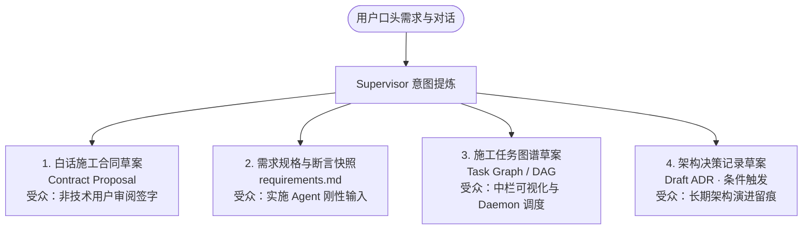
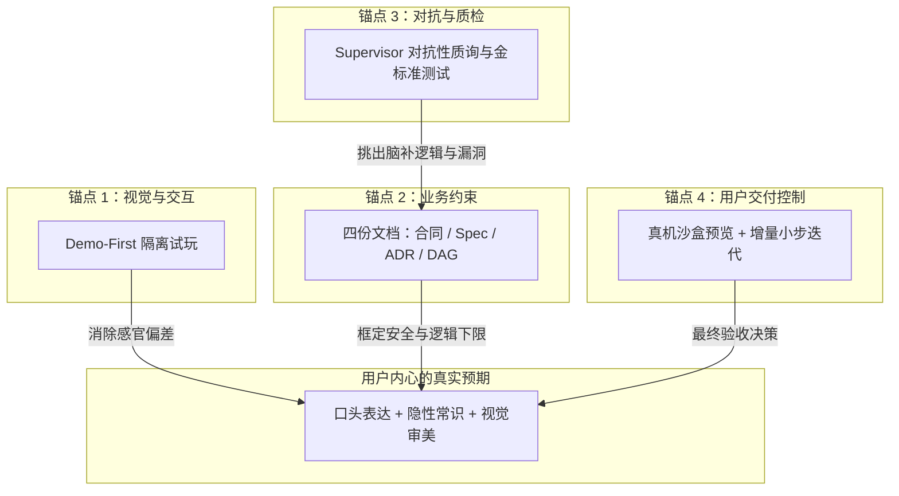
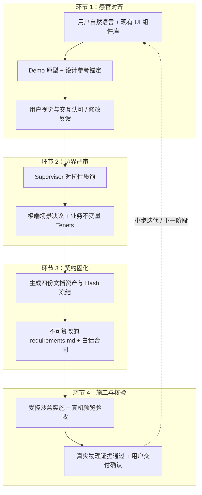
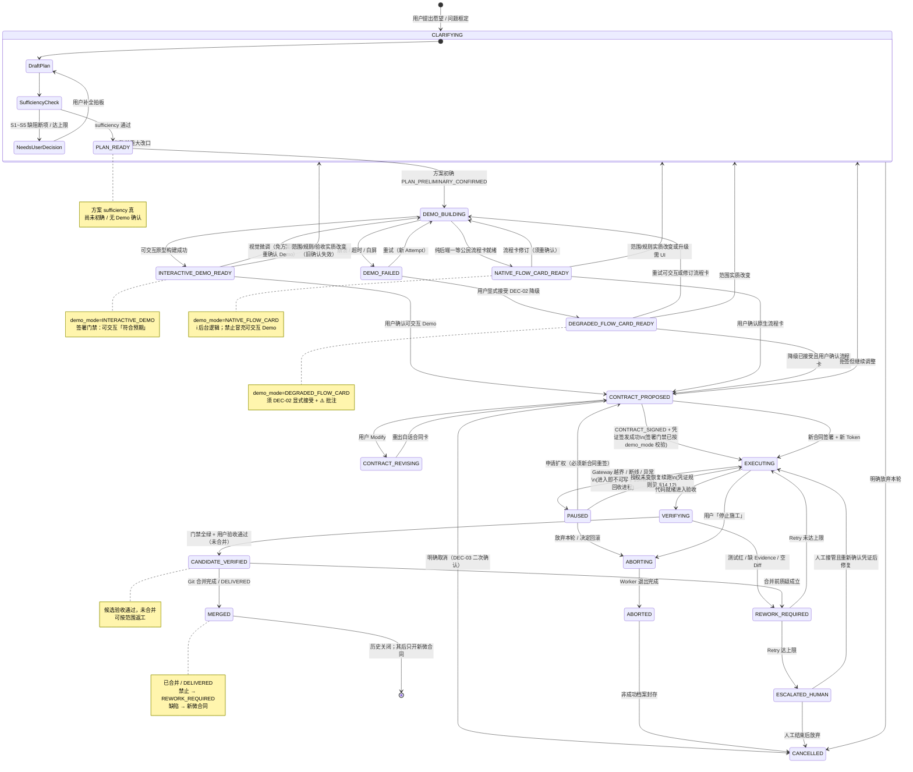

# Supervisor · 右栏对话时做什么（设计稿）

> **日期**：2026-10-26（Asia/Hong_Kong）  
> **状态**：**讨论稿** — 只定「对话时 Supervisor 干什么」；不改《架构规范》《任务规范》正文，不立卡、不动产品代码，除非 Tina「立卡」或「升格」。  
> **澄清结束产物（§8）**：**倾向采纳** — 4 份核心文档草案 + 1 份隔离 Mock Demo；全 DRAFT/PROPOSED，确认前无写权。  
> **文档不够保证「心中产品」（§9）**：**倾向采纳** — 静态文档只定安全下限；体验上限靠四重真实锚点（Demo-First / 设计参考 / 对抗性质询 / 微合同真机预览）。  
> **四锚点闭环 / 隐性逃逸 / 开工门禁 / 微合同（§10）**：**倾向采纳** — 感官→严审→固化→核验递进；5 条编码开工门禁；Micro-Contracts 为非技术交付最优解。v0.1 降级注：Impact 全收敛与「零未决」可收窄 Scope / 拆微步，不挡澄清结束。  
> **方案早、Demo 晚（§11）**：**倾向采纳** — 方案草稿可在需求很少很模糊时随对话自动生成/更新；Demo 不自动过早出——须自动检测「方案足以生成 Demo」且用户对方案**初步确认**后才生成；Demo 合意后再点「符合预期」并签合同，才写真码。  
> **日常方案草稿 vs 机器侧细稿 / 三层决策锁（§12）**：**倾向采纳** — 中栏日常方案 = 给人看的白话短稿；背后可另存更细机器稿（断言草案、影响面笔记、未决清单），默认折叠；签字前仍草案。决策治理用 Tenets 常驻 + ADR 条件触发 + 金标准用例在方案够稳/签合同前后落成，与大规范互补，不每轮硬写满三套。  
> **实现约束四条款 + P0–P3 + AC（§13）**：**倾向采纳** — sufficiency 结构化反脑补（11.2.1）；确认主里程碑体感分级（11.3.1）；草稿 `.stagent/` gitignore / Daemon 态（8.5.2）；方案视口稳定增量更新（12.1.1）；落地优先级 P0 草稿隔离 → P1 sufficiency → P2 确认主里程碑分级 → P3 防闪烁；附 AC-SUFF/CONF/ISOL/UX。  
> **异常回退 / 三层状态 / DEC-01～06（§14）**：**倾向采纳（基线）+ 产品决策 CLOSED + 工程边界 ENGINEERING-OPEN** — DEC-01～06 与四补钉的**产品选择**于 2026-10-26 由 Tina **CLOSED**（见 §14.8 / §14.9）；状态映射、资产存储与访问边界、签署/归档事务顺序、Demo 模式门禁、PAUSED 恢复凭证及返工计数身份等仍见 **§14.11 ENGINEERING-OPEN**。交叉修订含 Demo 视觉微调、局部失效回退、Worktree 封存（Git 安全路径）、session_epoch、非空 Diff；**PAUSED 经「扩权」必须重签新合同**。  
> **终局定案备注（2026-10-26，一致性修订同日）**：产品决策（DEC + 四补钉）**CLOSED**；**工程边界未全部钉死**（见 §14.11）；**本文仍为讨论稿**，CLOSED **不表示**能力已实现或已通过验证；未升格、未立卡，不算施工合同。  
> **用户意图锁定**（当日对话）：右栏保持 Cursor 式自由度；**不是**一句愿望直接写真代码；先由 Supervisor 落成**方案 + Demo**；Tina **确认后再**执行真实仓库开发。澄清宜少打断，关键分叉优先收进**方案草稿里的选项**，而不是聊天连珠炮。  
> **本稿依据**：真实软件开发里「需求澄清 / Discovery」怎么走（问题框定 → 现状与目标 → 边界 → 关键决策 → 验收与边角 → 冻结再实施），对照映射到右栏对话；并与 `Supervisor运转机制-2026-10-25.md`、Top7（澄清 ≤2 轮）、合同设计说明、C.11 体感链对齐。  
> **不是**：把 C.11 演示脚本当成产品主流程；演示卡只用来验按钮，日常对话应按下文澄清生命周期运转。

---

## 0. 一句话

**你在右栏像跟产品经理聊需求；Supervisor 按真实澄清阶段在背后写意图要点与方案草稿（可早、可模糊）；方案够具体且你初步确认后才出可点 Demo；只有会改「做不做 / 做到哪 / 怎么算完」的分叉才偶尔打断；Demo 合意并签白话合同之前，真写代码的门一直关着。**

---

## 1. 真实澄清怎么走 → Supervisor 怎么跟

软件开发里，需求澄清很少是「一次技术问卷」。常见是：**先弄清谁痛、做成什么样算成功**，再对齐现状与约束，画出做/不做，拍关键取舍，用例子和边角钉死验收，最后**冻结一版**再进设计与施工。Stagent 把同一条链路收进右栏对话 + 中栏产物：

| 真实澄清阶段 | 你在右栏说 / 看见 | Supervisor 默默做 | 何时可打断（仅范围敏感） | 产物 |
| --- | --- | --- | --- | --- |
| **① 收口与问题框定** | 一句愿望、抱怨、目标；可追问「给谁用、痛在哪」 | 归类意图；记下谁受益、要完成什么事（Job）、成功长什么样 | 若「给谁用 / 成功标准」完全两可且会改整轮 Scope → 方案里给选项，必要时一张推荐卡 | **意图要点**（DRAFT） |
| **② 现状 vs 目标 + 约束** | 「现在怎样 / 想变成怎样」；时间、合规、必须沿用的系统 | 只读摸现状（能摸多少摸多少）；标约束与假设；不装已懂全库 | 约束会否掉半个功能（如必须对接现有登录）→ 选项进方案 | 意图要点补全；假设清单 |
| **③ 范围边界（做 / 不做）** | 聊到「这轮先做啥、啥以后再说」 | 写 **In / Out / Non-goals**；大欲望建议切微步 | In/Out 打架或爆炸过大 → 推荐「先做哪一步」 | **方案草稿** 首版（含非目标） |
| **④ 关键决策与取舍** | 仍自由聊；中栏方案出现 2～3 个带「推荐」的选项 | 用业界安全默认填非核心细节；只把**改合同范围**的岔口显式列出 | 默认：**选项写在方案草稿**；仅当场不拍就无法往下 Demo 时才出右栏卡（累计 ≤2 轮） | 方案草稿（决策 + 推荐理由） |
| **⑤ 验收样子 / 例子 / 边角** | 「做成什么样算过」；举一个正确例子、一个不该发生的 | 把例子收成可验条目；边角用安全默认写进方案，标「可一键改」 | 边角会改 Scope（退款是否扣等级、匿名用户是否打折……）→ 同上闸门 | 方案草稿 · 验收与边角；合同字段草案 |
| **⑥ 冻结：方案初步确认 → Demo → 你确认** | 先对方案草稿点「大致对」；再中栏可点 Demo；白话合同卡；符合预期 / 改细节 / 拒绝 | 自动检测「方案足以出 Demo」；**仅在方案初步确认后**于隔离沙盒出 Demo（**0 写主工程**）；草拟护照；等你确认（见 §11） | 确认前**禁止**派 Coding Worker 真改仓库 | **Demo** + **合同草案**；确认后才进入实施编排 |

铁律不变：**提案与裁决分离**。Supervisor 只提案；你确认 Demo / 签白话合同；Daemon 才发可写凭证。

---

## 2. 每一阶段：对话里具体干什么

### 2.1 ① 收口与问题框定（Intake）

- **你**：随便说业务愿望，不必写成规格。  
- **Supervisor**：听完先回答「我听懂的是……」；抽出 *谁痛 / 要办成什么事 / 成功看起来怎样*；闲聊与改口都记进意图要点，**不立刻开题考技术**。  
- **打断阈值**：只有「用户是谁」或「成功标准」会把后续整轮做反时，才给选项（优先方案内）。

### 2.2 ② 现状 vs 目标 + 约束（As-is / To-be）

- **你**：补充「现在怎么用、哪里不爽、有没有死线 / 必须留的东西」。  
- **Supervisor**：对照仓库做**只读**了解（路由、已有模块、保护区线索）；把「沿用什么、碰不得什么」写进假设；对你用白话，不甩文件路径墙。  
- **打断阈值**：若不满足某约束就根本不该开这轮工，才问；否则默认写进方案让你最后一起看。

### 2.3 ③ 范围边界（In / Out / Non-goals）

- **你**：说「这轮先……就行」「积分商城以后再说」。  
- **Supervisor**：主动建议切蛋糕（对齐微步合同）；在方案里写清 **做 / 不做 / 明确非目标**，防止后面假绿或偷偷扩 Scope。  
- **打断条件**：你一句话同时指向两个不可同轮交付的大块 → 推荐「先做 A」并说明理由。

### 2.4 ④ 关键决策与取舍（Decisions）

- **真实研发里**：PM / 业务会拍「按累计消费还是付费订阅」「固定三级还是可配」——这才是分叉，不是 JWT 选型。  
- **Supervisor**：把分叉收成**业务场景选项 + 唯一推荐**；非核心用安全默认写进方案/合同草稿，避免连珠炮。  
- **与 Top7 对齐**：主动澄清 **≤ 2 轮**；推荐项必有；未决细项用安全默认进白话合同供一键确认。  
- **更像 Cursor 的默认**：选项优先出现在**方案草稿**，右栏少弹卡。

### 2.5 ⑤ 验收样子 / 例子 / 边角（Acceptance）

- **你**：用例子说话——「满 500 升黄金、结账自动打 95 折」「退款别把等级扣没」或「这个先不管」。  
- **Supervisor**：例子 → 可验条目；会改 Scope 的边角进闸门；不会改的边角静默写默认并标明。  
- **目的**：后面点亮与真机验收有对照，不是口头「做完了」。

### 2.6 ⑥ 冻结：方案初步确认 → Demo → 签合同后才施工（Freeze gate）

- **你**：先对方案草稿做**初步确认**（「大致对 / 先改方案」）；方案过关后再试 Demo；合意后点「符合预期」并签白话合同；拒约默认**留** Demo 与上下文（对齐 Top7）。  
- **Supervisor**：方案草稿可早出、随聊更新；**不**在方案未够具体或未经初步确认时自动出 Demo（ sufficiency 检测见 §11）；Demo 只在隔离原型区；合同是**提案**不是自批；未确认 Demo 且未授权合同 → **禁止**真写主工程 / Worktree 施工（与 C.11c、`assertDemoConfirmedForWrite` 一致）。  
- **确认之后**：对话变成进度、越界挂起、质疑回灰的通道，而不是继续自由改已签 Scope（要扩权 → 新卡重签）。

---

## 3. 「猜错会改合同范围」——对照真实分叉怎么判

Supervisor 每条用户消息做一次**范围敏感自检**（拿不准 → 按「会改」处理，宁问一轮不静默签错）：

| 通常算「会改范围」（可打断或写入方案必选票） | 通常不算（继续聊 / 静默改草稿） |
| --- | --- |
| 给谁用、主成功标准变了 | 换个说法、要解释、要举例 |
| In/Out 边界、是否动数据/权限/钱 | 文案语气、演示数据叫什么 |
| 验收例子与关键边角（退款、匿名、降级） | 已写进安全默认且你未反对的细节 |
| 做大做小、是否拆成下一张微合同 | 排期口吻、情绪、闲聊 |

**不是**自我感动的「全知」：规则是 **保守**——像靠谱 PM，拿不准就标成待决，放进方案选项，而不是假装已经定了。

---

## 4. 对话里同时存在的三条轨道

| 轨道 | 你看见 | Supervisor |
| --- | --- | --- |
| **A. 自由聊天** | 像 Cursor 右侧 | 听、答、记要点；不考开题 |
| **B. 方案 / Demo 起草**（默认主产出） | 中栏方案草稿、可点 Demo 逐渐成形 | 把 ①～⑤ 编译成可读方案 + 隔离原型；**0 写主工程** |
| **C. 分叉闸门**（偶尔） | 方案内选项；必要时右栏一张推荐选择题 | 仅范围敏感；≤2 轮 |

日常应以 **A + B** 为主；C 是闸门不是主界面。走查里连续点五步卡，是验收脚本，不是你每天的聊天节奏。

---

## 5. 明确不归右栏澄清的事

- 审 Diff、跑四件套、维护两份大规范正文 → 不是你的活。  
- 自批合同、自签 Execution、静默放行越界、假绿点亮 → Supervisor **禁止**。  
- 越界挂起、质疑自查与回灰 → 仍按运转机制 / C.11d–e：停住问你，不装没事。  
- Fast Path（改字号级小事）可不走完整 Demo，但越权必须升回标准澄清与授权（见非技术用户旅程）。

---

## 6. 和五阶段流水线怎么对读

| 本文澄清阶段 | 运转机制五阶段（对人半边） |
| --- | --- |
| ①～⑤（聊 + 写方案 / 验收条目） | **阶段 1** 意图启发与业务澄清 |
| ⑥ 出 Demo | **阶段 2** 只读探索与 Mock |
| ⑥ 合同草案与确认 | **阶段 3** 影响收敛与护照草案 → **你签字** |
| 确认之后的进度 / 越界 / 质疑 | **阶段 4～5**（派工、红队、证据、验收） |

Impact Analysis 完整 AST = **v0.2+**；v0.1 可降级保守 Scope + P.1——澄清阶段不得写成「已精准自动圈完依赖」。

---

## 7. 待你拍板后才能动的下步（本文不施工）

- [ ] 是否把「澄清进方案草稿、少右栏弹卡」**立卡**（建议接在 C.11 后）  
- [ ] 是否把本文从讨论稿 **升格** 为运转机制附录（或只保持报告归档）  
- [x] **中栏 / 正式资产区展示节奏** — 已 CLOSED，见 **§14.9 补钉-2**（中栏 Quiet Live Updates + 局部 Block Patch，遵守 §12.1.1；正式资产区仅在方案初确与合同签署两里程碑阶段性固化）  
- [ ] 是否将 **§8「澄清结束 4+1 产物」**（已标倾向采纳）升格进运转机制 / 核心资产治理，或单独立卡落地草稿区与哈希锁  
- [ ] 是否将 **§9「四重真实锚点」**（已标倾向采纳）写进澄清/验收旅程或立卡（Demo 反馈回写断言、对抗质询、设计参考、微合同切分）
- [ ] 是否将 **§13「实现约束四条款 + AC」**（已标倾向采纳）立卡：P0 `.stagent/` gitignore / 草稿隔离；P1 sufficiency Schema；P2 两次确认 UX；P3 视口增量更新
- [ ] 是否将 **§14「异常回退基线」**（已标倾向采纳）立卡：状态机分层、异常矩阵、PAUSED 扩权重签、Worktree 封存、session_epoch、非空 Diff；**产品决策 DEC-01～06 及四补钉已 CLOSED**（§14.8 / §14.9），立卡时按定案 + **§14.11 ENGINEERING-OPEN** 一并落地接口契约/状态表/验收测试，不再等待产品拍板

---

## 8. 澄清阶段结束时的文档产物（倾向采纳）

> **状态：倾向采纳**（2026-10-26 Asia/Hong_Kong）  
> Tina 提出「分层治理、职责隔离」的 4 份核心文档 + 1 份伴生 Mock Demo；Grok Bot 同意整体合理，并写入下列 3 条已共识微调。  
> **仍是讨论稿**：未改《架构规范》《任务规范》正文，未立卡、未改产品代码。

### 8.1 原则

在需求澄清阶段，Supervisor 生成的文档严格遵循「分层治理、职责隔离」：不生成混乱大杂烩，而是按**非技术用户 / 实施 Agent / 底层控制面（及长期架构留痕）**分受众产出。

更关键：**澄清阶段结束时，这 4 份文档全部处于 `DRAFT`（草案）或 `PROPOSED`（提案）状态**——没有生效执行权，更不会直接写入仓库主干分支。

### 8.2 已共识的 3 条微调

1. **ADR 保持条件触发**：不要每一轮澄清都强制出第 4 份；仅框架引入、公共接口破坏、数据模型重大调整等才生成，否则噪音大。  
2. **合同卡是给人签的护照**：`requirements` 哈希锁死可以；路径即便写成 `.stagent/…`，签字前也**只进草稿区 / 会话态**，**确认前不进主干**（与下文铁律 2、3 一致）。  
3. **图谱草案可以先灰、先粗**：节点与证据类型允许粗粒度；**不要在澄清结束就承诺精密到文件级的 Scope / AST**（Impact Analysis 完整 AST = **v0.2+**）。

### 8.3 4 份核心文档资产



| 文档名称与建议路径 | 核心内容 | 服务受众与作用 | 用户看到的呈现形态 |
| --- | --- | --- | --- |
| **1. 《白话施工合同草案》**<br/>`Contract Proposal`<br/>（内存对象 / 临时状态；签字前不进主干） | • 最终目标白话摘要<br/>• 影响文件清单（`writable_paths`，v0.1 可保守）<br/>• 绝不能碰的受保护资产<br/>• 验收标准与测试保障<br/>• 推荐执行模式（Mode 0–4） | **面向用户**：施工护照，定义权责边界；是点击「签字授权」的操作载体。 | 中栏卡片式《白话授权卡》（绿色「签署」等）。 |
| **2. 《需求规格与断言快照》**<br/>建议路径形如 `.stagent/specs/requirements.md`，**仅草稿区** | • 原始诉求转译与边界<br/>• 业务不变量（Tenets）<br/>• 明确排除范围（Negative Scope）<br/>• 可执行验收断言列表 | **面向实施 Agent**：签署后加锁只读，施工唯一输入依据；禁止 Agent 篡改。 | 默认折叠在授权卡下；非技术用户可略过，技术用户可展开。 |
| **3. 《施工任务图谱草案》**<br/>`TASK_GRAPH`（Draft；可 JSON） | • 子任务节点与编号<br/>• 前后依赖（DAG）<br/>• 每节点预期产出与证据类型（Unit/E2E/Lint，**可粗**） | **面向 Daemon / 调度与中栏**：拓扑顺序、并行串行边界；澄清结束时**灰图**即可。 | 中栏「施工图」（灰暗未点亮的流程节点）。 |
| **4. 《架构决策记录草案》**（**条件触发**）<br/>形如 `.stagent/adr/YYYYMMDD-*.md`（Draft） | • 决策背景<br/>• 选定方案与技术路径<br/>• 否决的替代方案及理由<br/>• 对历史 ADR 的继承或覆盖 | **面向长期工程健康**：仅重大架构/接口/数据模型变更时生成。 | 提炼为合同卡中一行「关键架构调整提示」；无则不出第 4 份。 |

### 8.4 伴生资产：1 份运行时非文档交付物

除上述 4 份文档，澄清阶段伴生：

- **《隔离前端交互原型代码》（Mock Demo）**  
  - 存放于临时预览沙盒，带隔离 CSP；  
  - **不是**项目源码；只为签署前让非技术用户在中栏可点试玩，避免「对着白纸黑字猜效果」。

### 8.5 澄清阶段文档生成的 3 条铁律

1. **不可篡改性准备（Hash Ready）**  
   澄清结束时，Supervisor 计算 `requirements`（断言快照）的 SHA-256。用户一旦签字，该哈希锁进执行凭证；实施 Agent 施工时只读，敢改则违规。

2. **只写临时暂存区，不污染代码树**  
   所有草案保存在 Supervisor 会话态或 `.stagent/drafts/`（及同类隔离区）中，**绝不**在确认前 Commit 到当前 Git 主干/工作分支当生效资产。

3. **提案态（Proposal Only）**  
   文档里的路径、断言、依赖在用户按下「确认签署」之前，对系统均为无效：Daemon **拒绝对其分配任何写凭据**。


#### 8.5.2 本地草稿存储防御与 Git 门禁豁免（**倾向采纳**）

澄清与草拟阶段生成的任何本地落盘资产（包括 `.stagent/drafts/` 下的 Spec/ADR/Graph 草案，以及 `.stagent/prototypes/` 下的 Mock 代码）：

1. **必须物理加入 `.gitignore`**：项目初始化时，Daemon 必须在工程根目录 `.gitignore` 中确保声明 `.stagent/` 规则，防止草稿文件在 `git status` 中表现为未跟踪文件（Untracked Files）。 **注意**：`.gitignore` 只影响 Git 是否跟踪，**不是**访问控制或 Worker 隔离边界；后者见 §14.8 DEC-01 / §14.11。
2. **优先内存/状态库留存**：在用户正式签署前，草案结构体应优先保存在 Daemon 运行时内存或独立 Session SQLite 数据库中，仅在必须由文件系统承载隔离预览时才落地到磁盘。
3. **门禁对齐保证**：签署后转正或生成 Worktree 时，所有仍处于草稿态的悬空文件不得穿透进入真实执行分支，严防触发 W.2b 的 `E_OUT_OF_SCOPE_UNTRACKED` 门禁阻断。

### 8.6 与本文前文章节的对读

| §8 产物 | 对应澄清阶段 / 轨道 |
| --- | --- |
| 意图要点 → 收进 Doc2 草稿 | ①～⑤；轨道 B |
| 方案草稿中的选项与非目标 | ③～④；优先方案内、少弹卡 |
| Doc1 合同草案 + Mock Demo | ⑥ 冻结门；你确认前 0 写主工程 |
| Doc3 灰图 | ⑥ 前后可视化；点亮属实施/证据阶段 |
| Doc4 ADR | 仅范围敏感的架构级分叉触发 |

**结论（倾向采纳）**：**4 份草案 + 1 份隔离 Demo、全 DRAFT/PROPOSED、确认前无写权** —— 可作后续立卡 / 升格的基线；ADR 条件触发、草稿区不进主干、图谱先粗后细三条微调一并生效；草稿物理隔离与门禁豁免见 **§8.5.2**（P0，AC-ISOL）。

---

## 9. 仅靠静态文档不够：意图鸿沟与四重真实锚点（倾向采纳）

> **状态：倾向采纳**（2026-10-26 Asia/Hong_Kong）  
> Tina 定性：仅凭 §8 四份文档（+ 伴生 Demo 若只当摆设）**绝对无法保证** Agent 做出「真正符合用户心中预期的商业产品」；若只靠文档宣称能完美还原意图，是虚假的技术安全感。  
> Grok Bot 同意并归档。**仍是讨论稿**：未改《架构规范》《任务规范》正文，未立卡、未改产品代码。

### 9.1 结论一句

> **这套文档（合同、Spec、ADR、TaskGraph）解决的是「施工队伍不会违规越界、不把房子拆塌、不偷工减料」——安全地基；  
> 要让房子「真正符合业主的居住品味」，必须靠【提前试玩 Mock 原型】+【对抗性质询逼出细节】+【设计参考锚住风格】+【拆小步真机预览验收】共同支撑。**  
> 文档不可或缺，但**替代不了**持续的感官对齐与小步反馈——这也是五步旅程必须保留「试玩 Mock」与「真机交付验收」的原因。

### 9.2 为什么仅靠文档必然存在「意图鸿沟」

文档擅长定义**安全下限**（不改坏什么、大致按什么规则跑），不擅长单独定义**体验上限**（好不好用、符不符合业务直觉、细节交互是否顺畅）。三个无法单靠文档消除的鸿沟：

1. **「用户不知道自己不知道」（默会知识难文档化）**  
   例如用户说「增加会员功能，按消费金额升」；心里默认可能还有金光特效、结算划线价、降级不粗暴清数据等。非技术用户不会主动写全；文档没有，Agent 按最简逻辑硬编码 → 功能「全对」，用户觉得「这根本不是我想要的」。

2. **「规范的符合」≠「业务的合理」**  
   `requirements` 写了十条断言、测试全绿，页面仍可能排版糟糕、按钮逆天、结算连弹三次确认。Agent 擅长过用例，不擅长品味与业务审美。

3. **LLM 的「合理化脑补」（Spec Interpretation Drift）**  
   文档任一处未穷尽（如「会员徽章放在个人中心」），实现时必须脑补位置与样式；微小偏差累积成完全不同的软件体验。

### 9.3 四重真实锚点（文档不是孤军奋战）

成熟 Stagent 理念里，§8 文档必须与下列四种物理锚点组成闭环，才能逼近用户内心预期：



| 锚点 | 要解决什么 | Supervisor / 产品侧怎么做 |
| --- | --- | --- |
| **1. Demo-First 隔离试玩** | 对着白纸猜效果 → 感官偏差 | 澄清阶段出隔离 Mock；用户在中栏点一点、填一填，几秒纠正「卡片该在上面」类偏差；反馈**回写**进 Spec/合同草案，而不只是口头说过。 |
| **2. 设计参考（Few-Shot / Design Reference）** | 文字断言不懂美学风格 | 合同或 Spec 附：已有 Design System / 组件规范、用户指定的竞品截图；无参考时**强制复用项目原有 UI 模式**，禁止自由造视觉轮子。 |
| **3. 对抗性质询（Adversarial Questioning）** | 灰色区域与脑补漏洞 | Supervisor 不只当秘书记笔记，还扮演苛刻技术总监：逼问结算瞬间退款怎么折算、99.99 是否算满 100 等边界，把默会常识晒进断言。 |
| **4. 微合同 + 真机试驾（Micro-Contracts & Live Sandbox）** | 一次交付完美系统不现实 | 大需求切成可连续验收的小合同；每步真机预览，用户说「行，继续」再开下一张；偏差在分钟级拉回，不给累积成灾难的机会。 |

### 9.4 与 §8 / 前文对读

| 说法 | 定位 |
| --- | --- |
| §8 四文档 + Demo 文件 | **安全地基与刚性输入**；够支撑「按签过的边界施工」 |
| §9 四重锚点 | **体验上限与意图逼近**；Demo 必须可试玩且反馈回写；质询补边角；参考锁风格；微步防偏差累积 |
| 本文 ①～⑥ 澄清生命周期 | 六步是对话节奏；§8 是结束时产物形态；§9 是「产物之外还必须靠什么」 |

**倾向采纳判定**：同意「文档 ≠ 心中产品」的定性；后续立卡 / 升格时，勿把 §8 单独写成「有 Spec 即可完美还原意图」——必须同时保留 Demo 试玩闭环、对抗质询、设计参考与微合同真机验收。

---

## 10. 四锚点怎么串成闭环、隐性逃逸、开工门禁与微合同（**倾向采纳**）

> 来源：Tina 补充的端到端对齐闭环、责任矩阵、默会知识逃逸表、编码开工门禁、Big Bang vs Micro-Contracts 对照。Grok 判定：**有助于设计 Supervisor，倾向采纳**；并注明 v0.1 降级（见 §10.5）。仍只写讨论稿，不立卡、不改规范正文 / 产品代码。

### 10.1 四重锚点的端到端对齐闭环

四种锚点不是孤立工具，而是按 **「感官对齐 → 逻辑逼问 → 契约固化 → 真实核验」** 递进串联：



**各环节输入、输出与责任边界**

| 环节 | 输入 (Inputs) | 输出 (Outputs) | 用户责任 | Supervisor 责任 | 执行底座 (Daemon/Gateway) 责任 |
| --- | --- | --- | --- | --- | --- |
| **1. 感官对齐**<br>(Demo + 参考) | 用户原始表述、现有代码 UI 组件库、竞品参考图 | 纯前端隔离 Mock Demo、视觉风格锚定清单 | 操作试玩，指出「感觉对不对、布局是否顺手」 | 提取交互特征，复用既有 Design System，快速渲染无副作用 Demo | 强制 CSP 与网络隔离，阻止 Demo 触碰持久化数据 |
| **2. 边界严审**<br>(对抗性质询) | 试玩通过的交互、系统现有业务规则、数据边界 | 澄清后的异常处理策略、明确的否定清单 (Negative Scope) | 拍板业务规则（如「并发时谁优先、退款是否降级」） | 扮演「挑刺技术总监」，从数据一致性、状态竞争、异常边界提出白话选择题 | 记录质询会话日志，确保未决问题不被静默忽略 |
| **3. 契约固化**<br>(文档生成) | 经过严审的业务决议、只读 AST 影响面分析结果 | 冻结的 `requirements.md`（含断言）、白话合同、模式判定 (Mode 0–4) | 审阅白话合同卡片，显式签署授权 | 静态裁剪 `writable_paths`，编写不可篡改的断言清单 | 计算 `spec_sha256`，签署后锁定为只读，颁发执行凭证 |
| **4. 施工与核验**<br>(真机预览) | 冻结的需求规格、执行凭证、专属 Git Worktree | 运行中的本地真机预览环境、物理测试报告 (Unit/E2E)、Diff 记录 | 在真实环境中完成核心场景实操验收，确认或提出质疑 | 转译测试证据为白话进度，检测范围溢出 | 拦截未授权写入与未跟踪文件，验收通过前阻断合并 |

与前文对读：环节 1～2 落在澄清六步 ①～⑤ + §9 锚点 1～3；环节 3 对齐 §8 产物与铁律；环节 4 是确认之后的实施与真机验收，**不再属于「澄清阶段内部」**，但闭环必须画完整，否则四锚点仍是口号。

### 10.2 仍可能遗漏的隐性预期及工程缓解

即使四重锚点全部运转，仍有四类默会知识极易逃逸：

| 逃逸的隐性预期类型 | 典型场景表象 | 根因剖析 | 确定性缓解方式 |
| --- | --- | --- | --- |
| **1. 性能感知与非功能体验** | 「点完按钮怎么卡了 1 秒？」「怎么没有骨架屏或加载转圈？」 | 用户默认「系统应当丝滑」，但不会主动提 Loading / 乐观更新 | **UI 骨架规则注入**：异步必带视觉反馈、页面加载必带 Skeleton、慢接口阻断二次点击——作为全局 Design System 硬规则进提示词 |
| **2. 隐性数据联动与级联一致** | 「我把用户删了，历史消费排行怎么还在报错？」 | 潜意识以为「删掉就干净了」，忽略外键 / 报表冗余 | **实体关系深度追溯**：影响面推导时 AST 向外延伸一层关联，主动预警 Cascade Impact（精密追溯属 v0.2+；v0.1 先白话预警 + 收窄 Scope） |
| **3. 极限设备与环境差异** | 「手机浏览器上按钮被底栏挡住了」 | 桌面验收与真实触屏/视口不一致 | **多视口容器化预览**：真机预览提供移动端 / 平板 / 桌面一键切换；可选扫码实机查看 |
| **4. 灾难恢复与防误触习惯** | 「点错『清空会员』连二次确认都没有就全没了」 | 非技术用户依赖容错；Agent 倾向「立即执行」 | **破坏性操作守护协议**：批量删除、金额修改、权限降级等——代码生成门禁强制二次确认对话框 |

### 10.3 编码开工门禁（Gating Criteria）

向执行 Gateway 下发 `Execution Token`、允许实施 Agent 敲第一行代码之前，以下 **5 个可观察条件**须全部亮绿灯；任一未达标 → **禁止签发执行凭证**，系统保持只读探索态（Mode 0）：

```
[门禁检查清单：进入受控施工前]
[✓] 条件 1：交互原型实机签收 (Demo Accepted)
    - 现象：用户在 Studio 中栏至少与 Mock 原型有过实质性交互（点选动作记录 > 0），且点击了「符合预期」。
[✓] 条件 2：零遗留未决分歧 (Zero Open Questions)
    - 现象：对抗性质询列表中，所有阻断级（Blocker）边界问题均已获得用户显式决议，会话中无「待定/看着办」悬空项。
[✓] 条件 3：影响面闭环且无未决依赖 (Impact Analysis Converged)
    - 现象：writable_paths 成功收敛至有限文件集合，静态分析未发现无法解析的动态反射调用，且核心保护区（如 auth、secrets）处于完全隔离状态。
[✓] 条件 4：需求断言可自动化验证 (Assertions Executable)
    - 现象：requirements.md 中的业务断言均能映射为具体测试手法（Unit/API/UI），不存在「体验良好、界面优美」等不可度量模糊文本。
[✓] 条件 5：物理指纹生成且合同显式签署 (Signed & Hashed)
    - 现象：Daemon 生成唯一 spec_sha256 并已只读锁定；审计库存在含工作区 SHA、用户签署时间戳与数字凭据的记录。
```

### 10.4 一次性完整交付 vs. Micro-Contracts 小步交付

| 比较维度 | 一次性完整交付 (Big Bang) | Micro-Contracts 小步交付 |
| --- | --- | --- |
| **用户认知与决策负担** | 前期极重，后期失控；验收面对海量改动，只能盲目「信任」 | 单次只确认一个子目标；几秒可清晰判断 |
| **偏差发现与修复成本** | 呈指数放大；底层误解污染整系统，易推倒重来 | 严格收敛在单步常数级；回滚 / 纠偏数分钟，无跨模块次生灾害 |
| **机器与工程开销** | 单次长跑，上下文易漂移，重跑代价高 | 多轮独立 Worktree / 凭证，基础治理开销略高，执行稳定性高 |
| **整体效率与心智模型** | 「看似快，实则慢」；反复推翻易失信心 | 「看似慢，实则快」；每步落袋为安，进度可感知、可度量 |

**工程推导结论（倾向采纳）**：面向非技术用户的商业软件交付，**Micro-Contracts 是系统性最优解**——用架构隔离把大模型创造力拆成可被人类常识验证的微步骤，是抹平「用户真实意图」与「代码现实」鸿沟的可靠途径（与 §9.3 锚点 4、Top7 微步合同一致）。

### 10.5 v0.1 降级注（Grok 微调，一并倾向采纳）

理想门禁与闭环仍按 §10.1～§10.3 写清；**落地 v0.1 时允许降级，避免把「澄清结束」卡死**：

1. **Impact 全收敛（条件 3）**：v0.1 Impact / AST 仍粗（对齐既有「精密圈文件属 v0.2+」）。拿不准时 **收窄 `writable_paths` / 拆微合同**，用更小护照开工，而不是因「分析未完美收敛」禁止结束澄清或永久卡在 Mode 0。保护区（auth、secrets 等）仍必须隔离。  
2. **零遗留未决（条件 2）**：阻断级（Blocker）必须拍板；非阻断「待定」可标进方案/合同的**安全默认 + 可一键改**，或拆到下一张微合同，**不挡本轮澄清结束与 Demo 确认**。  
3. **条件 1 / 4 / 5**（Demo 签收、断言可测、签署 + Hash）：v0.1 仍按硬门禁执行，与 C.11 体感链及 §8 铁律一致。

### 10.6 与 §8 / §9 对读

| 章节 | 回答什么 |
| --- | --- |
| §8 | 澄清结束时有哪些**产物**、什么状态、三条铁律 |
| §9 | 为什么产物不够、还要哪四类**锚点** |
| §10 | 锚点如何**串成闭环**、责任谁扛、隐性逃逸怎么补、**何时才准发 Execution Token**、为何默认微合同；以及 v0.1 哪些门禁可降级 |
| §11 | **方案 vs Demo 的时间闸**：方案可早；Demo 须 sufficiency + 方案初步确认；再「符合预期」+ 签合同才写真码 |
| §12 | **给人看的短方案** vs **折叠的机器细稿**；ADR / Tenets / Golden 三层决策锁（条件触发，不每轮写满） |

**倾向采纳判定**：采纳闭环、责任矩阵、逃逸缓解表、五门禁骨架与 Micro-Contracts 结论；采纳 §10.5 的 v0.1 降级，避免把未成熟的 Impact 全量分析写成「澄清不可结束」的硬墙。

---

## 11. 方案可早、Demo 须够具体且初步确认后再出（**倾向采纳**）

> 来源：Tina 确认——方案草案可以在需求很少很模糊时生成，但 Demo 不是；应自动检测是否到了「足以生成 Demo」的方案；方案随对话自动生成，关键分叉偶尔一张推荐选项；用户对方案**初步确认**后才生成 Demo；Demo 合意后再点「符合预期」并签合同，才写真码。Grok 判定：**倾向采纳**。仍只写讨论稿，不立卡、不改规范正文 / 产品代码。

### 11.1 两条时间线拆开

| 产物 | 何时可出现 | 自动？ | 用户门槛 |
| --- | --- | --- | --- |
| **方案草稿**（意图要点 / In·Out / 取舍选项 / 验收例子草案） | 需求**很少、很模糊**也可以；随右栏对话持续生成与更新 | **是** — 默默写中栏，不打断聊天 | 无硬门槛；关键分叉优先写进方案里的推荐选项（偶尔一张卡，≤2 轮） |
| **隔离 Mock Demo** | 仅当方案达到「足以生成 Demo」**且**用户对方案做过**初步确认** | **否（过早禁止）** — 不因聊了几句就自动出可点界面 | ① sufficiency 绿灯；② 方案初步确认（「大致对」类动作） |
| **真写主工程 / Worktree** | Demo 合意 +「符合预期」+ 白话合同签署之后 | **否** — Daemon 无签无写 | 对齐 §8 铁律、§10.3 开工门禁 |

一句话：**方案跟聊走；Demo 跟「方案过关」走；真码跟「Demo + 合同」走。**

### 11.2 「方案足以生成 Demo」自动检测（sufficiency）

Supervisor 在对话过程中持续评估方案草稿是否具备出 Demo 的最小信息；**未亮齐前只更新方案，不出 Demo**。建议可观察条件（v0.1 可粗，但须显式判定，禁止静默跳过）：

```
[Demo 生成前置：方案 sufficiency]
[ ] S1 谁用 / 成功长什么样 — 至少各有一句可展示的白话（可来自默认假设，但须标在方案里）
[ ] S2 本轮 In 范围可画成 1～3 个可点击主路径；**纯后端 / 无 UI** 时不以「降级」论，而是一等公民「数据流转 / 状态时序流程卡」（带假数据节点可试玩），仍须 sufficiency（见 §14.9 补钉-1）
[ ] S3 做 / 不做边界不自相矛盾；爆炸过大时已推荐切微步
[ ] S4 会改 Scope 的阻断级分叉：已有推荐决议，或已写入方案待用户拍（未决阻断级 → 不出 Demo，先澄清）
[ ] S5 至少一条可演示的「正确例子」（验收样子）；关键边角可用安全默认占位并标明
```

- **全亮** → 中栏出现「可以出 Demo 了」态（或等价提示），**仍不出 Demo**，直到用户对方案初步确认。  
- **未全亮** → 继续随聊补方案；可提示「还差什么才能试玩」，不弹技术填空墙。


#### 11.2.1 sufficiency 判定的机器提取规则（反脑补约束）（**倾向采纳**）

Supervisor 对 S1～S5 条件的评估**禁止**使用「LLM 自评是否充分」的主观自然语言判定，必须通过严格的结构化 Schema 提取进行布尔求值。仅当以下结构化字段全部解析成功且非空时，sufficiency 方可置为 `true`：

1. `target_user`: 明确的角色或受众定义字符串（非空）。
2. `core_job_to_be_done`: 成功标准的核心业务行动陈述（非空）。
3. `primary_interaction_flows`: 1～3 个包含离散步骤（Step Array，每条至少含触发源与期望反馈）的用户操作主路径。
4. `in_scope_items` & `out_of_scope_items`: 做与不做的显式条目数组，且二者交集必须为空。
5. `blocker_decisions`: 阻断级决策数组，其中所有项的 `status` 必须为 `RESOLVED`（已具备推荐值且用户未否决，或已完成选择）；任何 `status === 'OPEN'` 的阻断项直接判定 sufficiency 为 `false`。
6. `acceptance_examples`: 至少包含 1 条具象的 Happy Path 输入与预期输出映射。

若任一字段缺失或未能完成 Schema 校验，系统判定方案未就绪，继续停留在方案草拟与澄清阶段，**禁止**向前端暴露 Demo 生成动作。

### 11.3 方案初步确认 → 才生成 Demo

1. 用户对当前方案草稿点 **「大致对 / 按这个出 Demo」**（或等价显式动作；改口则方案回草稿、Demo 不生成或作废重来）。  
2. Supervisor 这才在隔离沙盒生成 / 刷新 Mock Demo（CSP、0 写主工程，对齐 §8 伴生资产）。  
3. 用户试玩；反馈写回方案（布局、文案、主路径），必要时小改 Demo；**不**因此自动开写真码。  
4. 用户对 Demo 点 **「符合预期」** → 合同卡可签（与既有「未确认 Demo 时授权灰」一致）。  
5. 签署白话合同 + `spec_sha256` 锁定 → 才进入受控施工（§10.3）。


#### 11.3.1 确认主里程碑体感隔离与语义分级（UX 认知保护）（**倾向采纳**）

澄清至施工全流程有且仅有 **两个主里程碑确认**（方案初确、执行授权）。二者在法律效力、界面形态和操作成本上必须形成明确代差。  
**另有条件触发的安全确认**（如 DEC-02 Demo 降级确认、DEC-03 放弃本轮二次确认、原生/降级流程卡确认等）——它们是安全门禁，**不计入**「仅两次主里程碑」，也不得被实现成与主里程碑同级的「又签了一次约」。

1. **主里程碑 A · 方案初确（低摩擦、无副作用、推进原型）**
   - **语义**：「方案方向大体认可，允许渲染隔离原型 / 流程卡」。
   - **界面表现**：位于中栏方案草稿卡片底部，表现为轻量建议按钮（推荐文案：`[✨ 生成试玩原型]`，辅以辅助按钮 `[继续调整方案]`；纯后端任务可用「生成数据时序流程卡」等价文案）。
   - **系统影响**：仅触发沙盒隔离原型或一等公民流程卡渲染，不分配任何写凭证，不冻结代码基线，不产生任何法律级授权约束。
2. **主里程碑 B · 合同签署 / 执行授权（高严肃、有安全围栏、下发凭证）**
   - **语义**：「本轮意图核验形态已确认，正式授权在约定 Scope 内修改主工程」。
   - **界面表现**：位于意图核验完成后的专属《白话施工合同卡》，带有醒目的绿盾安全标识、不可篡改哈希展示、受影响文件折叠清单与高对比度的主行动按钮（文案：`[确认授权并开始施工]`）。
   - **系统影响**：锁定 `spec_sha256`，向 Daemon 请求并派发 `Execution Token`，创建受控 Git Worktree，正式开启施工。
   - **签署门禁按 Demo 类型检查对应确认（禁止流程卡冒充可交互 Demo）**：
     - `INTERACTIVE_DEMO`：须用户对可交互原型「符合预期」；
     - `NATIVE_FLOW_CARD`：须用户对一等公民数据时序流程卡完成意图核验确认（合同卡可用 `ℹ️` 后台逻辑标注，**禁止**冒充为可交互前端 Demo）；
     - `DEGRADED_FLOW_CARD`：须先完成 DEC-02 降级显式确认，合同卡顶栏强制 `⚠️` 风险批注后，方可解锁签署。

**条件触发安全确认（不计入主里程碑次数）**：Demo 构建失败降级确认（DEC-02）、放弃本轮二次确认（DEC-03）、以及其它异常路径上的轻量确认窗。文案与样式须弱于主里程碑 B，避免「签了三次约」的体感。

**禁止**在方案初确阶段使用「签署」「授权」「生效」等强法律词汇，防止非技术用户产生「重复签字」的认知疲劳。

### 11.4 与前文对读 / 前端体感

| 章节 | 被 §11 收紧的点 |
| --- | --- |
| §0 / §1 ⑥ / §2.6 | 「方案 + Demo」拆成两段门：先方案初确，后 Demo；再符合预期 + 签合同 |
| §8 | Demo 仍是伴生资产，但生成时机从「澄清末期顺带出」改为「方案 sufficiency + 初确」之后 |
| §9 / §10 L1 感官对齐 | Demo-First 仍成立，但是 **Plan-ready Demo-First**：先有可确认的方案骨架，再感官试玩，避免对着空愿望空做界面 |
| §10.3 条件 1 | 「Demo Accepted」之前，增加隐式前置：方案曾初步确认且 Demo 非过早自动生成 |

对常用 Cursor 的非专业用户：右栏照旧随便聊，中栏会**很早**出现并更新方案草稿；**不会**一开口就丢一个可点 Demo 过来吵你。等你觉得方案「差不多对了」，再出 Demo 让你点感觉；合意并签字后，才像授权过的施工队开干。

**倾向采纳判定**：采纳「方案可早自动、Demo 须 sufficiency + 方案初步确认、Demo 合意 + 签合同后才写真码」；后续立卡时把 sufficiency 检测与「方案初确」显式动作写进 Studio 状态机，并与 `assertDemoConfirmedForWrite` 串联。实现时须同时满足 **§11.2.1（结构化 sufficiency）** 与 **§11.3.1（两个主里程碑 + 条件安全确认 + Demo 三态门禁）**，验收见 §13.2。

---

## 12. 日常方案草稿（给人看）vs 机器侧细稿；ADR / Tenets / Golden 三层锁（**倾向采纳**）

> 来源：Tina 问「日常方案草稿是什么？是显示给用户看的吗？不给用户看但保存起来的文档是否可以丰富一点？」；以及此前「是否应按 ADR + 产品价值观契约（Tenets / `DECISIONS.md`）+ 可执行验收规格（Golden Tests）写方案」的三段互补文档主张。Grok 判定：**倾向采纳**，并保留既有微调——**不**每轮澄清硬写满三套。仍只写讨论稿，不立卡、不改规范正文 / 产品代码。

### 12.1 日常方案草稿 = 中栏给人看的白话短稿

**日常方案草稿**就是中栏默认展开、随右栏对话自动更新的那一版，面向非技术用户（及常用 Cursor 的非专业开发者），不是给 Agent 的长规范拷贝。

| 维度 | 约定（倾向采纳） |
| --- | --- |
| **给谁看** | **给你看** — 中栏主视图；右栏仍像 Cursor 随便聊 |
| **写什么（宜短）** | 目标白话摘要；**做 / 不做 / 非目标**；带推荐的关键取舍；粗验收例子与「可一键改」的安全默认；未决分叉（若有） |
| **不写什么（默认藏起）** | 长篇文件路径墙、完整断言列表、AST 细节、DAG 全节点 JSON、ADR 全文 |
| **何时出现** | 需求很少、很模糊也可以出首版，并随聊覆盖更新（对齐 §11） |
| **状态** | 始终 **DRAFT**，直到你方案初步确认 → Demo 合意 → 签白话合同；签字前不进主干、无执行权（§8 铁律） |

对你而言：打开中栏应能在一屏内读完「这轮打算干什么、不干什么、还差你拍哪几板」——像产品经理的一页纸，而不是规格书全文。


#### 12.1.1 方案草稿随聊更新的视口保护协议（Viewport Stability）（**倾向采纳**）

当用户在右栏持续输入、Supervisor 持续修正中栏方案时，前端展示必须保证阅读稳定性，**禁止**整页重刷或粗暴覆盖：

1. **视口聚焦保护**：若用户当前鼠标正悬停在中栏、中栏处于滚动查看状态、或用户正在阅读展开的折叠项，严禁强制跳回顶部或强制折叠已展开内容。
2. **增量 Patch 与高亮提示**：方案变更必须采用差量（Diff Patch）更新机制，仅平滑替换变更的块（Block），并在发生调整的段落（如新增了 In 范围）添加温和的过渡淡入高亮。
3. **非聚焦态轻量提醒**：若更新发生时用户中栏处于静止状态，顶栏状态条显示微动效（如：「方案已根据最新对话更新」），确保用户对方案的演变过程始终感知平滑、不被打断。

### 12.2 机器侧细稿可以更丰富，但默认折叠 / 不打扰

**可以、也应该**在背后另存更细的机器可读草稿，用来支撑后续四份资产（§8）、对抗质询、Impact 与门禁——**默认不展开砸脸**；技术用户可主动展开；签字前仍是草案。

| 机器侧细稿（示例） | 建议落点（草案区） | 用途 | 用户是否默认看见 |
| --- | --- | --- | --- |
| 断言 / 验收条目草案 | `.stagent/drafts/…` 或会话内存 → 将来升格为 `requirements.md` | 实施 Agent 刚性输入；Hash Ready | 授权卡下**折叠**；非技术用户可不读 |
| 影响面 / `writable_paths` 笔记 | 同草案区 | 圈可写范围、保护区；供合同卡与 Mode 判定 | 合同卡上只见白话摘要；细表可展开 |
| 未决问题清单（Open Questions） | 会话 + 方案草稿角标 | Blocker 必须拍；非阻断可安全默认或拆微合同（§10.5） | 方案里用短标签提示「还差你拍 X」 |
| 灰图节点草稿 | `TASK_GRAPH` Draft | 中栏灰施工图；Daemon 调度草案 | 看见灰节点拓扑，不必读 JSON |
| 设计参考 / 组件锚定笔记 | 草案区 | Demo 与实施复用既有 Design System | Demo 里体现；清单可折叠 |

铁律不变：细稿再丰富，也只写**临时暂存 / 内存会话**；用户未签 → Daemon 不发写凭证；签后 `requirements` 等按 §8 锁 Hash、只读。

一句话：**给你看的短、给机器用的可以长；长的默认折叠，短的才是「日常方案」。**

### 12.3 三层决策锁（ADR + Tenets + Golden）——方向对，按条件触发

Tina 提出的三类互补文档，用来锁死决策、抑制长上下文漂移与自由发挥——**倾向采纳为项目级 / 条件级资产**，而不是「每一轮日常方案草稿都必须当场写满三套」。

| 层 | 文档 | 放什么 | 何时生成 / 引用 | 与日常方案的关系 |
| --- | --- | --- | --- | --- |
| **1. 愿景与价值** | 产品价值观契约（Tenets / `DECISIONS.md`） | 权衡排序（如安全可控 > 速度 > 功能）、红线 Never List、白话证据准则 | **常驻可引用**；澄清时 Supervisor 默默对照，灰色地带按 Tenets 选默认，而不是按模型「最省事」脑补 | 日常方案不复述全文；冲突时在方案里点名「依 Tenets：…」 |
| **2. 关键技术取舍** | ADR（Architecture Decision Records） | 背景、选定方案、**否决项与原因**、后果代价；禁止类决策（如「禁止 Supervisor 自行授权」） | **条件触发**（不可逆分叉、框架引入、公共接口破坏、数据模型重大调整、易被 AI 搞反的硬决策）；非每轮强制 | 日常方案只留一行「关键架构调整提示」；全文进 `.stagent/adr/…` Draft（对齐 §8 Doc4） |
| **3. 最终验收物理锁** | 可执行验收规格 / 金标准用例（Executable Spec / Golden Tests） | 用测试写死的意图（BDD / E2E / API 断言）；红则不得宣称做完 | **方案够稳、签合同前后**落成可跑断言；对齐 §8 `requirements` 断言与 §10.3 条件 4 | 日常方案只写白话验收例子；机器侧细稿持有断言草案 → 签署后锁 Hash |

另：系统与任务级依赖、状态机仍靠既有《架构规范》《任务规范》；日常方案与四份澄清资产是**本轮护照**，不取代宪法。

#### 为何有效（采纳理由，压缩）

1. **ADR**：大规范常只写「最终怎么做」，模型易自行「优化」；ADR 强制留下否决项，开工前可点名引用相关编号。  
2. **Tenets / `DECISIONS.md`**：需求未覆盖的灰色地带，用清晰排序与红线代替「流行默认」。  
3. **Golden / 可执行 Spec**：文字有解释空间，用例是物理契约；CI 红则无法假绿。

#### Grok 既有微调（与「倾向采纳」一并生效）

1. **不要每轮澄清硬写满三套** — 否则中栏噪音大、澄清拖死；日常方案保持白话短稿。  
2. **Tenets 常驻** — 每轮可引用，不必每轮重写。  
3. **ADR 条件触发** — 与 §8 Doc4 一致。  
4. **Golden 在方案够稳后落成** — 模糊期先白话例子 + 断言草案；sufficiency / 初确 / 签署前后再可执行化（对齐 §11、§10.3）。  
5. **大规范 = 宪法；本轮方案 / 合同 = 护照；ADR·Tenets·Golden = 防漂移锁** — 三者互补，不互相替代。

### 12.4 与 §8～§11 对读

| 章节 | §12 补上的点 |
| --- | --- |
| §8 | 四份资产里，用户主读合同卡白话；`requirements` / 图谱 / ADR 多为折叠或条件出现；机器细稿是其 DRAFT 前身 |
| §9 / §10 | Tenets + 对抗质询 + Golden 共同压缩「合理化脑补」；金标准是锚点 3/门禁 4 的物理形态 |
| §11 | 「方案自动生成」指的是**日常白话短稿**随聊更新；不是一上来生成完整 ADR+Golden 长卷；Demo 仍等方案初确 |

**倾向采纳判定**：采纳「中栏日常方案 = 给人看的白话短稿；机器侧细稿可更丰富但默认折叠、签字前仍草案」；采纳「Tenets 常驻 + ADR 条件触发 + Golden 在方案够稳/签合同前后落成」的三层决策锁，并明确**不**要求每轮日常方案写满三套。后续立卡时区分 `plan_draft_ui`（短）与 `plan_draft_machine`（富）两路存储，以及 Tenets 引用 / ADR 条件闸 / Golden 升格时机。中栏随聊更新须遵守 **§12.1.1 视口保护**；草稿落盘须遵守 **§8.5.2**（见 §13）。


---

## 13. 实现约束四条款的落地优先级与可验证验收（**倾向采纳**）

> 来源：Tina 将 sufficiency 反脑补、两次确认分级、草稿隔离、视口防闪烁四项评审建议改写为规范级条款，并附 P0–P3 排序与 AC。正文已分别插入 **§11.2.1 / §11.3.1 / §8.5.2 / §12.1.1**。Grok 判定：**倾向采纳**。仍只写讨论稿，不立卡、不改规范正文 / 产品代码。

### 13.1 风险排序与优先处理理由

| 优先级 | 风险项 | 安全影响 | 实现成本 | UX 体验影响 | 核心理由 |
| :--- | :--- | :---: | :---: | :---: | :--- |
| **P0** | 草稿隔离严密性（§8.5.2） | 高 | 低 | 高（阻断） | 系统致命性最高。未做物理隔离会导致未跟踪文件漏入工程，签署后直接触发 W.2b `E_OUT_OF_SCOPE_UNTRACKED`，施工链路崩溃。成本极低（`.gitignore` + 存储路由），必须最先钉死。 |
| **P1** | sufficiency 判定反脑补（§11.2.1） | 中高 | 中 | 高 | 意图对齐守门人。靠模型主观感觉会过早脑补出 Demo 或反复推迟。结构化校验是阻断幻觉的关键防线。 |
| **P2** | 确认主里程碑认知区分（§11.3.1） | 低 | 低 | 高 | 非技术用户核心心智。主里程碑仅方案初确与执行授权两档；条件安全确认不得做成同级「又签一次」。成本主要是文案 / 样式 / 事件名 / Demo 三态门禁，显著降低初用挫败。 |
| **P3** | 方案增量更新防闪烁（§12.1.1） | 无 | 中高 | 中 | 纯前端体验润色。不影响安全与状态机正确性；核心状态机跑通后收尾优化。 |

### 13.2 可验证的验收标准（Acceptance Criteria）

#### 13.2.1 sufficiency（AC-SUFF）

* **AC-SUFF-1（字段缺失拦截）**：输入仅含愿望的自然语言（如「我想做个积分商城」），当 `primary_interaction_flows` 为空或 `in_scope_items` 长度为 0 时，`checkPlanSufficiency(plan)` 必须返回 `{ sufficient: false, missing_fields: [...] }`，且前端「生成试玩原型」入口保持禁用或隐藏。
* **AC-SUFF-2（阻断未决拦截）**：方案中含 1 个 `status: 'OPEN'` 的阻断级分叉时，即使其他字段全满，`checkPlanSufficiency(plan)` 必须返回 `false`。
* **AC-SUFF-3（全量齐备放行）**：构造符合 Schema 的 6 项必填字段方案对象，`checkPlanSufficiency(plan)` 严格返回 `{ sufficient: true }`，中栏「生成试玩原型」入口转为可用。

#### 13.2.2 确认主里程碑与 Demo 三态门禁（AC-CONF）

* **AC-CONF-1（主里程碑 A · 无凭证）**：触发方案初确（点击 `[✨ 生成试玩原型]` 或等价流程卡入口）→ 发出 `PLAN_PRELIMINARY_CONFIRMED`；Daemon **绝不**下发 `Execution Token`、不创建 Worktree；按任务类型进入 `INTERACTIVE_DEMO` / `NATIVE_FLOW_CARD` 构建；白话合同卡保持未签署。
* **AC-CONF-2（主里程碑 B 依赖对应意图核验）**：未触发 `PLAN_PRELIMINARY_CONFIRMED`，或当前 Demo 类型尚未完成**对应类型**的用户确认前，合同卡「确认授权」主按钮必须 Disable（禁止跳过意图核验直接签合同）。  
  - `INTERACTIVE_DEMO`：须可交互原型「符合预期」；  
  - `NATIVE_FLOW_CARD`：须流程卡意图核验确认（**不得**把流程卡验收记成可交互 Demo 已确认）；  
  - `DEGRADED_FLOW_CARD`：须先有 DEC-02 降级显式接受事件，且合同卡顶栏带 `⚠️` 批注。
* **AC-CONF-3（主里程碑 B · 签署闭环）**：对应类型确认满足后合同卡解锁；点击「确认授权并开始施工」→ 发出 `CONTRACT_SIGNED`；`spec_sha256` 固化，Daemon 签发受控 `Execution Token`，状态进入 `EXECUTING`。
* **AC-CONF-4（条件安全确认不计入主里程碑）**：降级确认、放弃二次确认等安全确认可独立出现；测试须断言它们**不会**被记为第三次「方案初确」或第二次「执行授权」主里程碑事件。

#### 13.2.3 草稿隔离（AC-ISOL）

* **AC-ISOL-1（Git 干净度）**：多轮澄清并落盘 Draft / Prototype 到 `.stagent/` 后，工程根目录 `git status --porcelain` 输出必须为空（无 untracked 暴露给 Git）。
* **AC-ISOL-2（合并防穿透）**：一次施工合并的 Commit Tree **绝对不包含** `.stagent/drafts/*` 或 `.stagent/prototypes/*`。
* **AC-ISOL-3（W.2b 回归不报错）**：存在草稿文件时触发全仓 Scope 检查，必须 `PASS`，禁止抛出 `E_OUT_OF_SCOPE_UNTRACKED`。

#### 13.2.4 增量更新（AC-UX）

* **AC-UX-1（滚动位置不丢失）**：中栏滚至距顶约 `300px` 并展开某折叠面板后，右栏新消息触发方案更新 → 渲染后 `scrollTop` 仍在 `300px ± 10px`；已展开面板保持展开。
* **AC-UX-2（局部平滑更新）**：更新时仅变更文字节点变动；顶层 Container **不得**全量 Unmount/Remount。

### 13.3 与 §8 / §11 / §12 对读

| 条款 | 挂靠位置 | 解决什么 |
| --- | --- | --- |
| §8.5.2 | 铁律 2 的落地防御 | 草稿不污染 Git、不误触 W.2b |
| §11.2.1 | sufficiency 硬判定 | 禁止 LLM 自问自答放行 Demo |
| §11.3.1 | 两主里程碑 vs 条件安全确认；Demo 三态门禁 | 防止「签了两次/三次约」混淆；禁止流程卡冒充可交互 Demo |
| §12.1.1 | 中栏随聊更新 | 防整栏闪烁打断阅读 |
| §13.1～§13.2 | 本节省 | 落地顺序与可测 AC，供立卡直接引用 |

**倾向采纳判定**：四条款 + P0–P3 排序 + AC-SUFF/CONF/ISOL/UX 一并采纳为讨论稿实现约束；立卡时优先 P0 草稿隔离，再 P1 sufficiency Schema，再 P2 确认分级 UX，P3 视口稳定可后置。


---

## 14. 异常状态转移基线、三层状态联动与产品决策（**倾向采纳 + 产品 CLOSED + 工程 ENGINEERING-OPEN**）

> **状态：倾向采纳（异常基线）+ 产品决策 CLOSED + 工程边界 ENGINEERING-OPEN**（2026-10-26 Asia/Hong_Kong；同日一致性审阅修订）  
> 来源：Tina 指出澄清→Demo→签署→施工→验收主路径清晰后的 7 类异常断点；随后给出「分层状态 + 异常转移矩阵 + 四项默认回退 + 质疑规则」基线；再整理为三层 Mermaid、DEC 决策表与交叉自检修订。Tina 将 DEC-01～06 与四补钉的**产品选择**正式 **CLOSED**（§14.8 / §14.9）。同日一致性审阅要求：**不得**把「产品拍板」写成「设计层无歧义开放项已收口」——状态映射、归档安全、门禁映射等仍须工程定义（§14.11）。分层状态名仍为设计建议，不声称现网已实现。**本文仍为讨论稿**，CLOSED **不表示**能力已实现或已通过验证；未升格、未立卡，不算施工合同；不改规范正文 / 产品代码。  
> **硬约束补丁（必须一并生效）**：施工挂起 `PAUSED` 后若用户选「扩权」，**必须**走新合同重签 / 新凭证，**禁止**从图上的 `PAUSED → EXECUTING` 暗示静默扩权。  
> **区分口径**：**产品已拍板（CLOSED）** = DEC-01～06 与四补钉的产品选择不变；**工程仍须定义（ENGINEERING-OPEN）** = 状态映射、存储访问边界、事务顺序、门禁、凭证、计数身份等，见 §14.11 / §14.12。

### 14.1 为什么要补异常回退

主路径（Happy Path）在 §8～§13 已够清；以下异常若不钉死，会在实现时被笼统写成「全部重新开始」或「假绿继续」：

1. 澄清已 sufficiency 后用户大改口 / 方案推翻  
2. Demo「不符合预期」时退到哪、失败/白屏怎么报  
3. 拒签（Reject）vs 带条件修改（Modify）vs 明确取消  
4. 施工中 Abort、越界 `PAUSED`、断线重连  
5. 质疑后图谱回退、Worktree 复用、返工死循环断路器  

原则一句：**版本不覆盖、旧证据不冒充新证据、暂停不等于回滚、取消不等于删除、质疑不等于失败；任何继续施工都必须有仍有效的合同和凭证。**

### 14.2 三层状态解耦（建议设计名，非现网已实现断言）

把「本轮交付」与「资产 / 施工」拆开，避免例如「质疑后证据失效」被误写成「任务失败」从而错误重试或回滚。

| 层 | 建议状态名（示例） | 用途 |
| --- | --- | --- |
| **交付主生命周期** | `CLARIFYING`、`PLAN_READY`、`DEMO_BUILDING`、`INTERACTIVE_DEMO_READY`、`NATIVE_FLOW_CARD_READY`、`DEGRADED_FLOW_CARD_READY`、`DEMO_FAILED`、`CONTRACT_PROPOSED`、`CONTRACT_REVISING`、`AUTHORIZATION_FAILED`、`EXECUTING`、`PAUSED`、`ABORTING`、`ABORTED`、`VERIFYING`、`REWORK_REQUIRED`、`ESCALATED_HUMAN`、`CANDIDATE_VERIFIED`、`MERGED` / `DELIVERED`、`CANCELLED`；可选 `NEEDS_USER_DECISION`、`SUSPENDED`、`RECOVERY_REQUIRED` | 用户可见的本轮进度 |
| **资产状态** | 方案 / 合同按**版本**记录；Demo 类型字段：`INTERACTIVE_DEMO` / `NATIVE_FLOW_CARD` / `DEGRADED_FLOW_CARD`；Demo 生命周期：`READY` / `STALE` / `ARCHIVED` / `SUPERSEDED`；Evidence：`VALID` / `STALE` / `FAILED`；合同提案：`PROPOSED` / `REJECTED` / `SUPERSEDED` / `SIGNED` / `UNFULFILLED`；档案终态标签：`SUCCESS_ARCHIVE` / `NON_SUCCESS_ARCHIVE` | 可审计、可对照，不因 UI 阶段跳跃而丢历史 |
| **施工 / 任务状态** | 每任务：`PENDING` / `RUNNING` / `PAUSED` / `FAILED` / `REWORK_REQUIRED` / `CANDIDATE_VERIFIED`；每次尝试保留 Attempt 结果；Worktree：`ACTIVE` / 封存归档（manifest） | 局部返工与锁释放 |

**验收态拆分（P0，对齐 DEC-06）**：

| 状态 | 含义 | 质疑 / 返工规则 |
| --- | --- | --- |
| `CANDIDATE_VERIFIED` | 候选验收通过、证据绑定当前候选，**尚未**合并入主干 | 合并前质疑成立 → 可按范围进入 `REWORK_REQUIRED`（原合同 / 原 Worktree 规则仍适用） |
| `MERGED` / `DELIVERED` | 已合并入主干、历史关闭；合同与 Evidence、Commit Hash 锁死 | **禁止** `MERGED → REWORK_REQUIRED`；之后任何缺陷/改动只能开**新微合同**（DEC-06） |

> 旧稿中笼统的 `VERIFIED` **不得**再同时表示「验收通过」与「已合并完成」。实现映射表见 §14.11 ENGINEERING-OPEN。

### 14.3 五阶段异常状态转移矩阵（基线）

| 阶段 / 当前状态 | 触发条件 | 建议目标状态 | 资产与环境处理 | 用户界面反馈 |
| --- | --- | --- | --- | --- |
| 澄清：`CLARIFYING` | 用户提出新需求，实质改变目标、用户、范围或验收 | 留在 `CLARIFYING`，**新方案修订版** | 旧方案只读保留；新版**重算** sufficiency；不得把旧版字段悄悄混入新版 | 「需求方向已更新，正在整理新方案」；旧版可查看 |
| 澄清：方案已够（`PLAN_READY` / sufficiency 真） | 初确前重大改口 | 回 `CLARIFYING` | sufficiency 对新方案重算；旧版保留，不物理清空 | 禁用「生成试玩原型」；列出缺失/变化项 |
| 澄清：`CLARIFYING` | 达轮次上限仍有阻断未决 | 保持 `CLARIFYING` 或 `NEEDS_USER_DECISION` | 草案保留；不得以模型推断代替用户决议 | 少量明确选项指出阻断点；可稍后继续 |
| 澄清：任一未签署状态 | 暂时离开 / 断线 | 保持当前；会话可转 `SUSPENDED` | 保存最后一致快照与修订号；**不发**执行凭证、不删草稿 | 重连恢复到该版本，「上次停在这里」 |
| Demo：`DEMO_BUILDING` | 超时 / 异常 / 白屏（编译崩 / 死循环 / >30s） | `DEMO_FAILED` | 保留错误摘要与失败版本；不把失败 Demo 标为已确认 | 明确「Demo 未成功生成」；可重试，或按 **DEC-02** 有损降级为业务交互流程卡（须弹窗显式确认，严禁静默偷换） |
| Demo：`DEMO_FAILED` | 重试 | `DEMO_BUILDING` | 新 Attempt 号；旧日志保留 | 「正在重试」，不假装已有可试玩原型 |
| Demo：`DEMO_FAILED` | 用户显式接受有损降级（DEC-02） | `DEGRADED_FLOW_CARD_READY`（**不是**可交互 `INTERACTIVE_DEMO_READY`） | 流程卡/时序图代替可交互原型；记录 `demo_mode=DEGRADED_FLOW_CARD`；合同卡顶栏强制 `⚠️ 本次交付基于交互流程卡确认，无实机交互原型` | 白话合同卡仅在用户点降级确认后解锁；**禁止**把降级接受记成可交互 Demo 已确认 |
| Demo：纯后端 / 无 UI（补钉-1） | sufficiency 通过且方案初确 | `NATIVE_FLOW_CARD_READY` | 一等公民数据时序流程卡；假数据无副作用模拟；合同卡 `ℹ️` 后台逻辑标注 | 按流程卡确认解锁签署，**禁止**冒充 `INTERACTIVE_DEMO` |
| Demo：`INTERACTIVE_DEMO_READY` / `NATIVE_FLOW_CARD_READY` / `DEGRADED_FLOW_CARD_READY` | **仅**文案/颜色/布局等呈现细节（未改 S1～S5） | 保持方案版本；新 Demo 修订版；**旧 Demo 接受状态失效** | 旧 Demo → `ARCHIVED`；须用户对**新** Demo **重新确认**后才能签署；**免**方案初确（见 §14.7 / §14.12） | 改动摘要 + 前一版预览；提示「原型已更新，请再确认」 |
| Demo：任一 READY | 主流程 / 范围 / 关键业务规则 / 验收条件 / 可见交互改变 | 回 `CLARIFYING`（或至少重算 sufficiency → `PLAN_READY`） | 方案新建修订；旧 Demo → `STALE`；**撤销**旧 Demo 接受状态，**不得**再用于签署 | 「这会改变本轮范围，方案需要重新确认」 |
| Demo：任一未完成对应类型确认 | 未试玩/未确认就试图签署，或 Demo 未就绪 | 保持签署前 | 不冻结合同、不发 Token；按当前 `demo_mode` 检查门禁 | 签署按钮禁用并说明缺什么（类型不符时明示，禁止静默冒充） |
| 合同：`CONTRACT_PROPOSED` | 改可写路径 / 范围 / 验收 / 风险条件 | `CONTRACT_REVISING` → 再回 `CONTRACT_PROPOSED` | 原提案保留为旧版；相关字段变则哈希重算；**旧签名不得复用** | 「合同草案已更新，请检查变更」 |
| 合同：`CONTRACT_PROPOSED` | 拒签但愿意继续改 | 回 `CLARIFYING` 或 `CONTRACT_REVISING` | 默认保留 Demo 与上下文；旧提案 `REJECTED` / `SUPERSEDED`，不删除 | 合同卡「未授权」+ 继续修改入口 |
| 合同：`CONTRACT_PROPOSED` | 明确取消本轮 | `CANCELLED` | 默认**归档**草稿/Demo/签署前指纹与原因；释放会话租约；不删用户可见历史 | 「本轮已取消」+ 只读历史 + 另起新需求 |
| 合同：签署链路 | 签名 / 哈希冻结 / 凭证签发任一失败 | 回 `CONTRACT_PROPOSED` 或 `AUTHORIZATION_FAILED` | **事务式**：未全部成功不得部分进入施工；不创建可写 Worker | 「授权未生效」，不得出现「施工已开始」 |
| 合同已签 / `EXECUTING` | 用户提出影响已签 Scope 的新要求 | **先暂停**，再开**新合同版本**；旧合同不可变 | 停止旧凭证继续授权；新范围重新审核、**重签**；受影响 Evidence 失效 | 「这超出当前授权，需要新合同」——**不是**已批准扩权 |
| 施工：`EXECUTING` | Gateway 拦越界 | `PAUSED` | 阻断本次 IO；保留 Worktree / 日志 / 违规证据；不静默放行、不默认销毁现场 | 越界位置 + 选项：「缩小改动 / **申请新授权（重签）** / 放弃本轮」 |
| 施工：`PAUSED` | 用户选「扩权」 | **不得**直接静默回 `EXECUTING` | 必须进入新合同提案 / 重签 / 新 Token；旧 Token 吊销或冻结 | 明确「新授权合同」卡，禁止一键静默放行 |
| 施工：`EXECUTING` | 用户主动停止 | `ABORTING` → 进程确认退出后 `ABORTED` | 先协作式停止，超宽限期再强杀；保留 Worktree 快照，**不合并**；删除须用户确认或明确保留期策略 | 「正在停止」→「已中止，改动留在隔离区，未合入主线」 |
| 施工：`PAUSED` | 进入 `PAUSED`（越界 / 断网 / 异常） | 保持 `PAUSED` | **立即**禁止 Worker 继续写文件（执行暂停）；算力进程可暂留但不可执行；启动 15 分钟回收倒计时（DEC-04）；保留现场；**不**因断线自动扩权或删 Worktree | 重连用快照+增量恢复挂起卡与待决选择 |
| 施工：`PAUSED` | 15 分钟内无操作 | 仍为 `PAUSED`（休眠） | **仅**此时终止/回收 Worker 进程并保存命名快照；不等于「挂起期间仍可写」 | 「施工现场已休眠，恢复约需 2–3 秒」 |
| 施工：`EXECUTING` | Daemon / Worker / 机器异常退出 | `PAUSED` 或 `RECOVERY_REQUIRED` | 以持久化状态与最后确认事件恢复；不从猜测继续写；先核凭证、候选指纹、进程状态 | 「施工中断，正在核对现场」；确认前不显示继续施工 |
| 验收：`VERIFYING` | 测试失败或缺 Evidence | 任务 `FAILED` / `EVIDENCE_MISSING`；交付未达 `CANDIDATE_VERIFIED` | 失败证据保留；未跑/空集/旧 Evidence **不得**当通过 | 标出未通过项与缺失证据 |
| 验收：`CANDIDATE_VERIFIED`（未合并） | 用户质疑且成立 / 证据不足 | 受影响节点 `REWORK_REQUIRED`；Evidence → `STALE` | 旧 Evidence 留审计；下游按依赖 `STALE`/`BLOCKED`；合同范围未变时可在原隔离 Worktree 返工 | 图谱「需复核/返工」，不伪装从未发生 |
| 验收：`MERGED` / `DELIVERED` | 合并后发现问题 | **不得**回到本轮 `REWORK_REQUIRED` | 旧合同锁死；必须开立新微合同（DEC-06） | 「本轮已交付关闭，请开新微合同」 |
| 验收：`REWORK_REQUIRED` | 自动返工耗尽 / Scope 不足 / 无法判定 | `ESCALATED_HUMAN`，或经用户选择 `CANCELLED` | 冻结现场与诊断包；停 Worker，确认退出后释放执行锁；合同「未完成/待人工」，不假绿；**刚进入 `ESCALATED_HUMAN` 时不得按终止态 GC**（§14.12） | 失败原因、已尝试次数、「人工接管 / 结束本轮」 |
| 验收：指纹不匹配 | 代码/合同/Demo/基线变化导致 Evidence 不一致 | 受影响任务及依赖 → `STALE` | 仅重跑受影响证据；引用仍一致者可沿用 | 解释失效原因与需重跑项 |
| 验收全绿（未合并） | 用户验收通过且证据绑定当前候选 | `CANDIDATE_VERIFIED` | 固化证据与候选指纹；**尚未**封存最终交付三件套 | 通过项、仍有限制、「确认合并入主线」入口 |
| 合并入主干 | Git 合并完成 + 审计写入 | `MERGED` / `DELIVERED` | 执行 DEC-01 阶段二最终归档；之后新需求 / 缺陷只开新版本或新微合同 | 交付完成；历史只读 |

### 14.4 四项默认回退与资源保留

| 场景 | 建议默认 | 不建议 |
| --- | --- | --- |
| 方案改口 | 保留旧版，创建新版；对新版重算 sufficiency。只复制仍明确有效的字段并标明来源；实质改变时旧 Demo 失效 | 覆盖旧方案、沿用旧 sufficiency 绿灯，或不经检查把旧流程字段并进新需求 |
| Demo 被推翻 | 默认保留历史 Demo，标旧版失效。纯呈现微调 → 同方案版本更新 Demo；改主流程/范围/规则 → 先修订方案并重检 sufficiency，再出新 Demo | 静默覆盖唯一 Demo；拿旧 Demo 继续解锁签署 |
| 拒签或取消 | 「拒签但愿意改」→ 方案/合同修订，保留上下文与 Demo；「明确不做了」→ `CANCELLED`，资产默认归档只读，释放租约 | 拒签一律永久取消；默认 `rm -rf` 清草稿与审计 |
| 施工中止 | `ABORTING` → 确认停止后 `ABORTED`；默认保留隔离 Worktree 与现场快照，不合入主线；删除须确认或保留期策略 | 强杀后立刻删 Worktree；Abort 只改 UI、后台仍在写 |

「保留」= 可审计、隔离、**不可继续授权执行**的快照。过程垃圾在签署时按 **DEC-01 阶段一**物理 GC；交付核心三件套在验收合并后按 **DEC-01 阶段二**永久归档至 `.stagent/records/{contract_id}/`（永久保留的是**脱敏后的完整记录**，不是未处理明文；见 DEC-01 / §14.11）。

### 14.5 质疑后的 Graph、Worktree 与重试

**Graph（局部失效回退，非整图变灰）**

1. 先核对质疑对应的合同断言、候选指纹与 Evidence。  
2. 证据仍有效且质疑不成立 → 节点保持 `CANDIDATE_VERIFIED`（合并前）或维持已合并只读结论，记录结论。  
3. 证据不完整或质疑成立（**仅合并前**）→ 相关节点 `REWORK_REQUIRED`；旧 Evidence → `STALE`。  
4. **仅**下游依赖按拓扑变 `STALE`/`BLOCKED`；无相关上游保持候选通过态。  
5. 修复并新 Evidence 通过后才恢复 `CANDIDATE_VERIFIED`。  
6. **已 `MERGED` / `DELIVERED`**：禁止把旧轮次转回 `REWORK_REQUIRED`；只能开新微合同（DEC-06）。

不建议把质疑直接记为 `FAILED`：`FAILED`≈执行/测试实际失败；`STALE`≈依据过期；`REWORK_REQUIRED`≈需再施工（合并前）。

**Worktree**

- 同一签署合同、同一 Scope、候选未合并：默认原隔离 Worktree 修补，每次返工独立 Attempt + 快照。  
- Scope / 授权 / 候选基线变：暂停 → 新合同审核；是否新 Worktree 由新合同基线定；旧 Worktree 留审计。  
- 已合并后再发现问题：开新缺陷/变更合同，不回写旧合同历史、不伪造「未发生」。  
- 回滚主线必须单独授权、单独验收。

**重试上限（DEC-05 CLOSED；计数身份须工程钉死）**

- 同一验收断言/具体缺陷最多 **2** 次自动返工；初次实现不计入。  
- **计数绑定稳定身份**：`contract_id + acceptance_assertion_id` 或 `contract_id + defect_id`；同一问题换措辞 / 拆标签 / 重述 **不重置**计数；该问题修复并验证通过后才关闭。  
- **改变范围或新增断言**须经授权流程（用户确认 / 合同修订）；**禁止**模型自行创建新 ID 清零断路器。  
- 达上限 → `ESCALATED_HUMAN`：停自动循环、保留现场与诊断、确认停进程后释放施工锁、合同标未完成；人工接管须重确认操作者/范围/凭证；Mode 4 **不**自动扩大权限；**不得**在刚 ESCALATED 时按终止态 GC。  
- **新维度**独立断言/缺陷（稳定新 ID，经授权）各自再享 2 次（防过早锁死）。  
- 高风险（钱/权限/核心数据）可更早人工接管；**不得**由模型自行提高上限。

### 14.6 三层状态联动 Mermaid（讨论稿）



> **读图注意**：  
> 1. `PAUSED → CONTRACT_PROPOSED → EXECUTING` 才是「扩权」路径；`PAUSED → EXECUTING` 仅表示**授权未变**时的断线恢复续跑，**不是**扩大 Scope。  
> 2. **禁止**用单一 `DEMO_READY` 同时表示可交互原型、原生流程卡与降级流程卡。  
> 3. **禁止** `MERGED → REWORK_REQUIRED`；合并前用 `CANDIDATE_VERIFIED → REWORK_REQUIRED`。  
> 4. 签署边必须隐含「当前 `demo_mode` 对应确认已满足」。

### 14.7 交叉自检修订（冲突 / 遗漏补丁）

| 编号 | 问题 | 修订（倾向采纳） |
| --- | --- | --- |
| PATCH-1 | Demo 视觉微调是否要再「方案初确」？ | **免方案初确，但须重确认 Demo**：未改 S1～S5 时同方案版本出 `Demo v1.x`，**无需**再点方案初确；但任何影响已确认体验的 Demo 更新都使**旧 Demo 接受失效**，用户须对新政原型/流程卡再确认后才能签署。增加功能/改主流程才强制回方案重审。 |
| PATCH-2 | 「质疑回灰」易被理解成整图变灰 | 正式定名 **局部失效回退（Targeted Invalidation）**：仅被质疑项 → `REWORK_REQUIRED`；下游依赖 → `STALE`；无关上游保持候选通过态（合并前）。 |
| PATCH-3 | `ABORTED` 后旧 Worktree 与新需求冲突 | **中止隔离封存协议（禁止莽撞改名）**：优先使用 Git 支持的 `worktree move` / `remove` 流程；或**保持目录路径不变**，由归档 manifest 标记封存并解绑执行锁。**禁止**直接 OS 级「改名 Worktree」以致损坏 git worktree 管理关系。操作失败时**不得**释放锁并启动可能冲突的新 Worktree。 |
| PATCH-4 | 双 Tab / 双端并发改方案与试 Demo | 合同卡与 Demo 绑定 **`session_epoch`**；另一会话导致方案版本变更时，过期 Tab 收 WebSocket 遮罩：「方案已在另一会话更新」——**禁止**用过期 Demo 触发签署。 |
| PATCH-5 | Worker「摸鱼」零写入仍点亮图谱 | `VERIFYING` 前增加 **非空物理 Diff 校验**：非纯探测任务若 `git diff` 为空（或仅空白），直接 `REWORK_REQUIRED`，禁止无物理变动假绿。 |
| PATCH-6 | 图上 `PAUSED→EXECUTING` 写「扩权重签」易被实现成静默放行 | **扩权 = 新合同**：必须重算范围/哈希、重签、发新 Token；旧凭证停止授权。缩小改动可在原合同内继续；放弃走 Abort/Cancel。 |

### 14.8 六项产品决策记录（DEC-01～06，**CLOSED** · 2026-10-26）

> **状态：CLOSED**（Tina 终局产品定案，2026-10-26 Asia/Hong_Kong）  
> 下列六条取代此前「推荐默认 + Open Items」表；**产品选择**已 CLOSED。实施级状态映射 / 存储边界 / 事务与门禁等见 **§14.11 ENGINEERING-OPEN**，不得解读为「工程也全部无歧义」。仍写入**讨论稿**，未升格、未立卡。

```
================================================================================
                    STAGENT DEC-01 ~ 06 终局产品定案 (CLOSED)
================================================================================
```

#### DEC-01 CLOSED — 两阶段归档 + 写入前脱敏 + 签署时过程 GC（产品选择）

**永久保留的是什么（产品拍板）**：用户完成交付（`MERGED` / `DELIVERED`）后，在隔离目录 `.stagent/records/{contract_id}/` 永久归档**脱敏后的**交付核心三件套（**不是**未处理的明文原文）：

1. **脱敏后的完整对话记录**（立项原声与质疑记录经脱敏；可审计、可回放意图，但凭证类秘密已打码）；  
2. **最终生效方案全貌**（面向用户的白话方案、时序图/流程图/拓扑图快照，以及最终确定的 Mock Demo / 流程卡快照包）；  
3. **最终专业结构化图纸**（锁定 SHA-256 的 `requirements.md`、`TASK_GRAPH` DAG 节点、`writable_paths` 范围与触发的 ADR）+ 代码 Commit SHA。

**写入前强制脱敏（产品拍板）**：持久化落盘前须经敏感特征过滤；高危 API Key（如 `sk-***`）、生产数据库连接密码等凭证类秘密**严禁明文落盘**。当前定案**不承诺**「永久保留未脱敏原文」；若将来要保留未脱敏原文，必须另定受保护存储、访问与删除规则（见 §14.11），不得与「严禁明文落盘」字面冲突。

**`.gitignore` ≠ 访问控制（P0 澄清）**：将 `.stagent/` 写入 `.gitignore` 只防止草稿进 Git 索引，**不是** ACL、沙盒或执行隔离。Prototype / Records / Worker Worktree 的真实隔离边界见 §14.11 ENGINEERING-OPEN；**禁止**仅靠「只读 + gitignore」声称 Worker 无法访问 prototypes/records。

**两阶段触发（解耦）+ GC 事务顺序**：

| 阶段 | 触发 | 动作 | 状态含义 |
| --- | --- | --- | --- |
| **阶段一：签署合同**（Pre-Execution Freeze & GC） | 用户点击「确认授权并开始施工」 | ① **先**原子写入并校验当前签署快照、合同、`spec_sha256`、审计事件；② 校验成功后，再 GC 当前合同可重建的临时碎片（未采纳 Draft v1/v2、临时 AST 缓存等）；**任何归档/冻结写入失败都不得 GC** | **施工基线冻结态**——尚非最终完工归档 |
| **阶段二：验收入主干**（Post-Verification Final Archive） | 门禁全绿，用户验收通过并完成 Git 合并 → `MERGED`/`DELIVERED` | 将**脱敏后**对话记录、最终方案快照、结构化图纸以及 Commit SHA 统一打包封存至 `.stagent/records/{contract_id}/`；写入完成审计标志；会话租约正式终结；档案标签 `SUCCESS_ARCHIVE` | **最终完工归档** |

若施工中止 `ABORTED` 或取消 `CANCELLED`：在中止时打快照归档并清理，档案标签为 **`NON_SUCCESS_ARCHIVE`（非成功终态）**，**不得**放进「最终交付三件套」或标为已完成（§14.12）。

> 本地 records 的备份、换机迁移、项目删除、用户导出/删除与访问主体仍属 **ENGINEERING-OPEN**（§14.11）；产品仅拍板「脱敏后永久保留三件套 + 两阶段时机 + GC 不得先于成功写入」。

#### DEC-02 CLOSED — Demo 构建失败允许有损降级，但必须用户弹窗显式确认

- **触发条件**：隔离沙盒 Mock 原型发生编译崩溃、死循环、白屏或生成超时（如 >30s）。  
- **降级形态**：允许有损降级为「结构化交互流程卡 / 状态时序流程图」，用可视化流程节点代替可交互前端页面。  
- **强确认门禁（反偷换）**：系统**严禁静默偷换**。必须弹出显式确认卡：「交互原型生成异常，已为您梳理【业务交互流程卡】，您是否接受以此作为方案理解依据？」  
- **合同卡风险批注**：仅当用户显式点击确认接受后，白话合同卡才解锁，且卡片顶端必须带有醒目标注：`⚠️ 本次交付基于交互流程卡确认，无实机交互原型`。

> 纯后端 / 无 UI **不是**本条降级路径，见 **§14.9 补钉-1**（一等公民流程卡）。降级成功态记为 `DEGRADED_FLOW_CARD` / `DEGRADED_FLOW_CARD_READY`，**禁止**写入 `INTERACTIVE_DEMO` 已确认。

#### DEC-03 CLOSED — 放弃本轮须轻量二次确认，中栏置灰只读

- **二次确认防误触**：用户在白话合同卡点击 `[放弃本轮需求]` 时，弹出轻量确认窗：「本轮需求将终止，当前方案将归档为已放弃，确定放弃吗？」，防止手抖误触导致沟通心血丢失。  
- **置灰只读与心智平复**：确认放弃后，中栏方案**绝不粗暴清空**，而是整体置灰并打上「已放弃」水印，所有交互按钮禁用。右栏恢复常态：「本轮需求已取消并归档，你可以随时开始聊新需求。」

#### DEC-04 CLOSED — `PAUSED` 立即不可写 + 15 分钟回收进程，Worktree 快照休眠唤醒

- **进入即暂停执行（与断线「不继续执行」对齐）**：一旦进入 `PAUSED`，Worker **立即不可继续写文件**；即使进程暂未退出，也只能等待唤醒，不得执行 IO。  
- **15 分钟只决定资源回收**：启动 **15 分钟**倒计时；若期内无操作，再安全退出 Worker 进程、切断容器算力并保存命名快照 `snapshot-{contract_id}`——**不是**「挂起 15 分钟内仍可写」。  
- **无缝唤醒**：用户重连时展示「正在唤醒施工现场 (约需 2-3 秒)...」，读快照恢复现场；挂起决策卡原样展现。授权未变续跑时的 Token / 进程恢复规则见 §14.12（ENGINEERING-OPEN 细节）。

#### DEC-05 CLOSED — 验收质疑自动返工上限 2 次，按断言维度独立计数

- **单个问题上限 2 次（断路器）**：针对同一条验收断言或具体缺陷，Agent 最多自动返工 **2** 次（初次施工不计入）。若连续 2 次修改后测试仍未通过或用户仍指出相同缺陷，系统立即熔断，转入 `ESCALATED_HUMAN`（Mode 4），彻底截断死循环。  
- **计数身份（产品要求；实现属 ENGINEERING-OPEN 细则）**：绑定稳定键 `contract_id + acceptance_assertion_id` / `defect_id`；同一问题重述、换标签、拆句**不重置**；修复并验证通过后才关闭该键。改变范围或新增断言须经授权；**禁止**模型自造新 ID 清零。  
- **新问题独立计算（防过早锁死）**：经授权的全新维度独立断言/缺陷，各自再享 2 次自动返工。  
- **仅适用于合并前**（`CANDIDATE_VERIFIED` 及之前）；已 `MERGED` 走 DEC-06 微合同，不走本轮断路器清零。

#### DEC-06 CLOSED — 已交付合并后强制开立微合同，自动只读引用上轮背景

- **历史合同绝对不可变**：一旦进入 `MERGED` / `DELIVERED`（已合并入主干、历史关闭），该轮合同及其 Evidence、Commit Hash 彻底锁死，**绝对禁止**直接在旧合同上打补丁、重新激活，或 `MERGED → REWORK_REQUIRED`。  
- **合并前 vs 合并后**：`CANDIDATE_VERIFIED`（候选验收通过、未合并）上的质疑可按范围返工；**合并后**发现问题只能开新微合同。  
- **缺陷修复微合同（Micro-Contract）**：后续任何遗留 Bug 或微小改动，必须开立独立缺陷修复微合同。  
- **只读引用上轮上下文**：新微合同自动只读引用上轮核心业务背景与 In-Scope 作为参考，但必须基于当前主线真实代码重新推导最小影响面，走「轻量初确 → 发新凭证 → 受控施工」闭环。

---

### 14.9 四补钉（CLOSED · 与 DEC 同日钉死）

> 下列四条补齐「纯后端 Demo 形态、§7 展示节奏、归档/GC 时机、Demo 路径流转」四处实现分歧点；**补钉-3 已并入 DEC-01 两阶段**，此处不重复矛盾条款。

#### 补钉-1 CLOSED — 纯后端 / 无 UI = 一等公民流程卡（非 DEC-02 降级）

- **非「降级」，而是原生交互流程卡**：纯后端/数据重构任务（例如「优化数据库查询索引」「重构支付 Webhook 验签逻辑」）**不属于** DEC-02 的「构建崩溃降级」，而是系统自适应的第一等公民（First-Class）原型形态。  
- **形态表现**：中栏直接渲染「数据流转 / 状态时序流程卡（State & Data Flow Card）」，用带假数据的节点（如 `请求进入 → 鉴权校验 → 事务写入 → 触发通知`）供用户试玩触发。  
- **无副作用硬约束**：流程卡**只用假数据做无副作用模拟**，不得触发真实 Webhook、写生产/开发数据库或外部通知。若后续发现本轮必须改 UI，则升级为 `INTERACTIVE_DEMO`（或相应原型模式）并**重新确认**。  
- **免去降级风险批注**：此类任务**无需**在合同卡上打「⚠️ 原型崩溃」负面警告，而是标注：`ℹ️ 本任务属于后台逻辑服务，已通过数据时序流程卡完成意图核验`；记录 `demo_mode=NATIVE_FLOW_CARD`，**禁止**冒充可交互 Demo。

#### 补钉-2 CLOSED — §7 中栏方案展示节奏：双模态分离 + 三位置命名

**三位置命名（避免「资产区」混谈）**：

| 名称 | 是什么 | 不是什么 |
| --- | --- | --- |
| **中栏实时草稿** | 随聊 Quiet Live Updates / Block Patch 的当面方案 | 不是代码树文件；不是已签资产 |
| **会话暂存快照** | 方案初确时推送的 `PLAN_DRAFT_V1` 等会话级快照 | 不是项目代码树；不是已签资产；方案大改后旧暂存标 `SUPERSEDED` |
| **签署后项目资产记录** | 合同签署后锁定 SHA-256 的 `requirements.md`、合同快照等受控项目资产视图 | 仍不等于 Worker 施工目录；与 `records/` 最终封存分工见 DEC-01 |

- **中栏日常方案草稿：随聊「平静持续更新」（Quiet Live Updates）**：严格遵守 **§12.1.1**；局部 Block Patch，不跳顶、不整页重刷。  
- **阶段性固化（Phase-Gated Promotion）**：澄清期间**绝不**频繁把草稿推成签署后项目资产；仅两里程碑：  
  1. **方案初确** → 写入**会话暂存快照** `PLAN_DRAFT_V1`；  
  2. **合同签署** → 转正为**签署后项目资产记录**。

#### 补钉-3 CLOSED — 归档与 GC 时机（已并入 DEC-01）

见 **§14.8 DEC-01**：签署合同 = 冻结 + 过程 GC；验收入主干 = 最终封存 `records/`；`ABORTED`/`CANCELLED` = 中止时快照归档并清理。本处不另立冲突规则。

#### 补钉-4 CLOSED — Demo 原型路径流转（`prototypes/` → `records/`）

1. **澄清与试玩期（活跃态）**：Demo 文件生成并运行在 `.stagent/prototypes/{prototype_id}/`，受独立 CSP 保护；同时应在 `.gitignore` 中忽略以免污染 `git status`——**gitignore 仅此用途**。  
2. **合同签署期（锁定态）**：签署后，Daemon 打上 `prototype_sha256`；施工期将该目录视为比对基准（Golden Benchmark）。Worker **禁止**修改——落实须靠目录/沙盒/权限边界（§14.11），**不能**仅靠「只读标记 + gitignore」。  
3. **验收合并期（归档封存）**：`MERGED`/`DELIVERED` 后，Daemon 将核心快照**拷贝**至 `.stagent/records/{contract_id}/demo_snapshot/`，随后原 `prototypes` 可重置或复用。

---

### 14.10 与 §8～§13 对读 + 闭环判定（修订后）

| 章节 | §14 补上的点 |
| --- | --- |
| §7 | 展示节奏产品 CLOSED → **§14.9 补钉-2**（三位置命名）；升格/立卡仍待 Tina 点头 |
| §8 / §8.5.2 | 取消/中止默认**归档**而非 rm；`.gitignore` 防污染 Git，**不是**安全边界；终态脱敏三件套进 `records/`（DEC-01）；隔离细节 → §14.11 |
| §10 / §11 | 主路径门禁不变；Demo 三态与签署门禁见 §11.3.1 / §13.2.2；纯后端见补钉-1 |
| §11.3.1 | **两个主里程碑**（方案初确、执行授权）+ 条件触发安全确认；拒签二次确认（DEC-03）属后者 |
| §12.1.1 | 中栏 Quiet Live Updates 必须遵守视口保护（补钉-2） |
| §13 AC | 立卡时按 AC-CONF 三态门禁 + §14.11 / §14.12 增补工程验收 |

**闭环判定（2026-10-26，一致性审阅后）**：

> DEC-01～06 与四补钉的**产品选择**已 **CLOSED**；实施所需的状态映射、资产存储与访问边界、签署和归档事务顺序、Demo 模式门禁、PAUSED 恢复凭证及返工计数身份仍须在接口契约、状态表和验收测试中明确。**本文为讨论稿**，以上 CLOSED **不表示**能力已实现或已通过验证。

换言之：**产品方向已拍板；工程边界未全部无歧义。** 不得再使用「设计层无歧义开放项已收口」一类过满结论。未升格、未立卡，不算施工合同。

---

### 14.11 ENGINEERING-OPEN（工程仍须定义）

> 下列条目**不推翻** DEC / 四补钉的产品选择；它们是实现者若脑补就会分歧的硬核细节，须在接口契约、状态表与验收测试中另文钉死后再立卡施工。

| ID | 主题 | 待定义要点（清单，非定案） |
| --- | --- | --- |
| EO-01 | 状态映射 | 设计态（`PLAN_READY`、三 Demo READY、`CANDIDATE_VERIFIED`、`MERGED`/`DELIVERED` 等）↔ 现网 / Daemon 状态机字段与迁移 |
| EO-02 | 存储与访问边界 | Prototype / Records / Worker Worktree 是否分目录、分容器、分 uid；能否经宿主路径、符号链接、进程权限互访；**禁止**仅用 gitignore/只读旗标充当 ACL |
| EO-03 | records 生命周期 | 本地永久归档的备份、换机迁移、项目删除、用户导出/删除、谁可访问；云端是否另存 |
| EO-04 | 脱敏覆盖面 | 除最终文件外：DB、崩溃日志、遥测、备份、导出；凭证类秘密 vs 影响业务理解的个人信息如何分级，避免误删导致需求快照失真 |
| EO-05 | 签署/归档事务顺序 | 阶段一「原子写入校验 → 再 GC」的具体事务原语、失败回滚、GC 对象白名单与恢复策略 |
| EO-06 | Demo 模式门禁 | `demo_mode` 字段、确认事件名、合同卡解锁谓词；防流程卡冒充可交互 Demo 的测试矩阵 |
| EO-07 | PAUSED 恢复凭证 | 旧 Token 是否仍有效、进程已退出如何恢复、是否续发新 Token、如何保证旧凭证不能并行使用 |
| EO-08 | 返工计数身份 | `acceptance_assertion_id` / `defect_id` 生成与稳定规则、跨质疑会话归属、签署前后计数是否结转 |
| EO-09 | Worktree 封存 | Git `worktree move/remove` vs 路径不变+manifest 的选型、失败不放锁的实现 |
| EO-10 | 未脱敏原文（若需要） | 另定受保护存储、访问、保留期与删除；**当前产品定案不承诺明文永久落盘** |

---

### 14.12 验收与边界补丁（讨论稿要求写入实现 AC）

立卡 / 写验收测试时至少覆盖：

1. **Demo 确认后方案或合同变化**：若修改范围、业务规则、验收条件或可见交互 → **旧 Demo 接受状态失效**；更新/重生成后须按当前 `demo_mode` **再次确认**；合同哈希重算时必须同步撤销旧接受（不得只重算哈希却沿用旧确认）。  
2. **视觉微调（PATCH-1）**：免「方案初确」，但影响已确认体验的 Demo 更新 → **必须重新确认 Demo**。  
3. **纯后端流程卡**：假数据、**无副作用**（无真实 Webhook / DB 写 / 外部通知）；后来需要改 UI → 升级原型模式并重新确认。判据不能仅靠「`writable_paths` 无前端文件」。  
4. **脱敏覆盖面**：见 EO-04；产品底线是凭证类严禁明文；覆盖面扩展属 ENGINEERING-OPEN。  
5. **取消 / 中止 / 升级人工**：`CANCELLED` / `ABORTED` 归档为 **`NON_SUCCESS_ARCHIVE`**，不得标成最终交付三件套或已完成。`ESCALATED_HUMAN` 是待接管态——**刚触发时不得按终止态 GC**；仅当用户结束本轮或人工接管流程结束后再封存。  
6. **PAUSED 授权恢复**：图上 `PAUSED → EXECUTING`（授权未变）时，须在契约中写清：旧 Token 有效性、进程已退出时的恢复步骤、是否续发、如何阻止旧凭证并行使用（EO-07）。

---

*文档结束。冲突时：Top7 硬标准与《Supervisor运转机制》定稿优先；本稿只细化「右栏对话按真实澄清生命周期怎么表现」、澄清结束产物形态（§8 倾向采纳）、「文档地基 + 四重锚点」的意图对齐边界（§9 倾向采纳）、四锚点端到端闭环 / 隐性逃逸 / 开工门禁 / 微合同与 v0.1 降级（§10 倾向采纳）、「方案可早、Demo 须够具体且初步确认后再出」（§11 倾向采纳；确认语义见 §11.3.1）、「日常白话方案 + 折叠机器细稿 + Tenets/ADR/Golden 三层决策锁」（§12 倾向采纳）、「实现约束四条款 + P0–P3 + AC」（§13 倾向采纳），以及「异常回退基线 + 三层状态 Mermaid + 交叉补丁 + **产品决策 DEC-01～06 / 四补钉 CLOSED** + **§14.11 ENGINEERING-OPEN** + **§14.12 边界补丁**」（§14）。本稿仍为**讨论稿**：产品选择已拍板，工程边界未全部钉死；CLOSED 不表示已实现或已验证；未升格、未立卡。*
