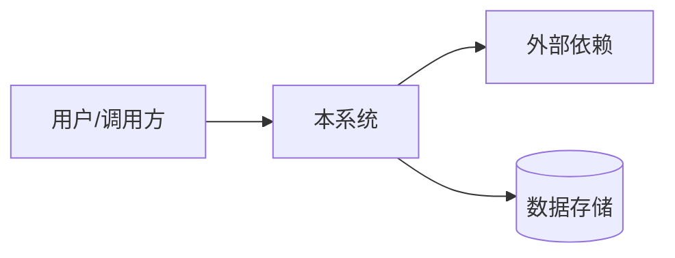
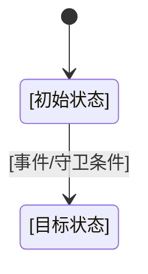

# [产品/功能/迭代名称] 系统设计与接口契约

> 复制后替换方括号内容。此文档说明如何满足已确认需求，不得自行改变产品决策；需改变时回到 PRD 或记录 ADR。

## 文档信息

| 字段 | 内容 |
|---|---|
| 项目/产品 | [名称] |
| 迭代/版本 | [标识] |
| 技术负责人 | [姓名/角色] |
| 评审人 | [姓名/角色] |
| 状态 | [草稿 / 评审中 / 已确认 / 已替代] |
| 版本 / 更新日期 | [版本] / [YYYY-MM-DD] |
| 上游 PRD | [文档链接与版本] |
| 验收/追溯文档 | [链接] |
| 相关 ADR | [ADR-ID 与链接；没有则无] |

## 1. 设计摘要与约束

- **设计目标**：[要满足哪些 REQ/NFR]
- **设计原则/硬约束**：[安全、兼容、运行环境、现有技术约束]
- **非目标**：[本设计不解决什么]
- **关键假设**：[未经验证的前提]
- **待决项**：[引用 OQ-ID，指出受影响模块]

## 2. 系统上下文与边界

描述系统、用户、外部服务与信任边界。图可用 Mermaid 或链接，确保正文也能说明关键责任。



| 组件 ID | 组件/服务 | 职责 | 输入/输出 | 信任边界/权限 | 需求引用 |
|---|---|---|---|---|---|
| ARCH-001 | [组件] | [职责] | [I/O] | [边界] | [REQ-ID] |

## 3. 数据模型与不变量

| DATA ID | 实体/字段 | 类型、单位与约束 | 生命周期/保留 | 敏感性/访问规则 | 来源需求 |
|---|---|---|---|---|---|
| DATA-001 | [实体.字段] | [类型、单位、唯一性等] | [规则] | [规则] | [REQ-ID] |

### 数据不变量
- **INV-001**：[始终成立的约束]，对应 [REQ/AC/TEST]。
- [如无额外不变量，写明无。]

### 数据迁移与兼容
- 当前版本：[版本/未知]
- 迁移方案：[步骤]
- 回滚/向前兼容策略：[说明]
- 数据丢失或不可逆风险：[说明]

## 4. 状态机与并发行为



| 状态 | 含义 | 允许的进入条件 | 可发生的操作 | 终态/限制 |
|---|---|---|---|---|
| [STATE] | [含义] | [条件] | [操作] | [限制] |

- 非法状态转换如何拒绝：[行为、错误码/事件]
- 并发冲突与幂等：[锁、版本检查、幂等键或其他策略；不适用需说明]
- 超时、取消、重试：[策略]
- 失败补偿/恢复：[哪些副作用需要撤销或清理]
- 对应需求与测试：[REQ/AC/TEST-ID]

## 5. 接口契约

为每个外部可见接口分配 `API-###`；接口可以是 HTTP、RPC、事件、CLI、文件格式或内部模块边界。

### API-001：[方法与路径/事件名]

- **目的**：[作用]
- **调用方 / 被调用方**：[角色/组件]
- **授权与前置条件**：[认证、权限、状态]
- **幂等性/重试**：[规则]
- **超时/限流**：[确定值或 OQ-ID]
- **关联需求**：[REQ-ID / AC-ID]

**请求**

```json
{
  "field": "<类型、是否必填、约束>"
}
```

**成功响应**

```json
{
  "result": "<结构与语义>"
}
```

**错误与拒绝行为**

| HTTP/协议码 | 稳定错误码 | 触发条件 | 是否可重试 | 调用方应如何处理 |
|---|---|---|---|---|
| [码] | [ERR_*] | [条件] | [是/否/条件] | [行为] |

**兼容性**：[版本策略、字段新增/弃用规则]

> 不要仅写“返回 500”。业务可预期拒绝应有稳定错误分类；避免在响应中泄露秘密或敏感信息。

## 6. 安全与隐私设计

| SEC ID | 资产/威胁/边界 | 控制措施 | 失败时行为 | 验证方式 | 需求引用 |
|---|---|---|---|---|---|
| SEC-001 | [描述] | [最小权限/隔离/验证/脱敏等] | [拒绝/暂停/告警] | [TEST/审核] | [REQ-ID] |

- 身份认证与授权：[说明]
- 数据隔离与对象级权限：[说明]
- 秘密、凭证与日志脱敏：[说明]
- 输入校验、路径/资源边界：[适用时说明]
- 审计事件与保留：[说明]
- 威胁建模/安全评审：[范围、结果或 OQ-ID]

## 7. 运行、故障与可观测性

- 运行/部署拓扑：[环境与依赖]
- 健康检查与关键指标：[指标及意义]
- 日志/追踪：[字段、脱敏、关联 ID]
- 故障模式与降级：[故障 -> 行为]
- 备份、恢复与回滚：[责任、目标或 OQ-ID]
- 运维手册/告警：[链接或待补项]

## 8. 性能、容量与可用性

| NFR ID | 场景/负载 | 指标 | 目标 | 测量方式 | 当前证据/状态 |
|---|---|---|---|---|---|
| NFR-001 | [场景] | [指标] | [目标或 OQ-ID] | [方法] | [未测/结果] |

## 9. 架构决策与替代方案

- 已引用 ADR：[ADR-ID 与链接]
- 本设计中待记录为 ADR 的决策：[选择、影响、为何需要 ADR]
- 尚未选择的方案：[OQ-ID]

## 10. 需求与验证映射

| 设计 ID | 设计要点 | 关联 REQ | 关联 AC/TEST | 状态/证据 |
|---|---|---|---|---|
| ARCH-001 | [设计要点] | [REQ-ID] | [AC/TEST-ID] | [计划/实现/验证] |

## 11. 待决问题与变更记录

| OQ ID | 问题 | 影响范围 | 阻断级别 | 选项/临时方案 | 决策人 | 截止/复审点 |
|---|---|---|---|---|---|---|
| OQ-001 | [技术/架构/接口未决内容] | [架构模块/API/数据/安全] | [BLOCKER / NON_BLOCKER] | [未批准方案不可视为默认] | [架构师/角色] | [开工前 / 压测前 / YYYY-MM-DD] |

| 日期 | 版本 | 变更 | 评审/批准 |
|---|---|---|---|
| [日期] | [版本] | [变更] | [结果] |
